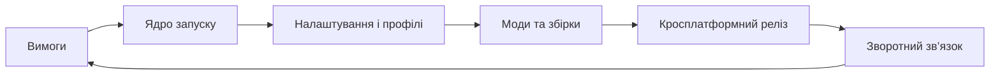
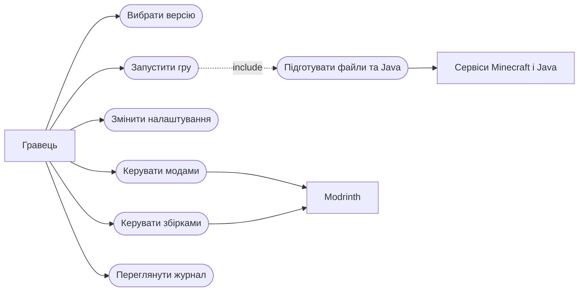
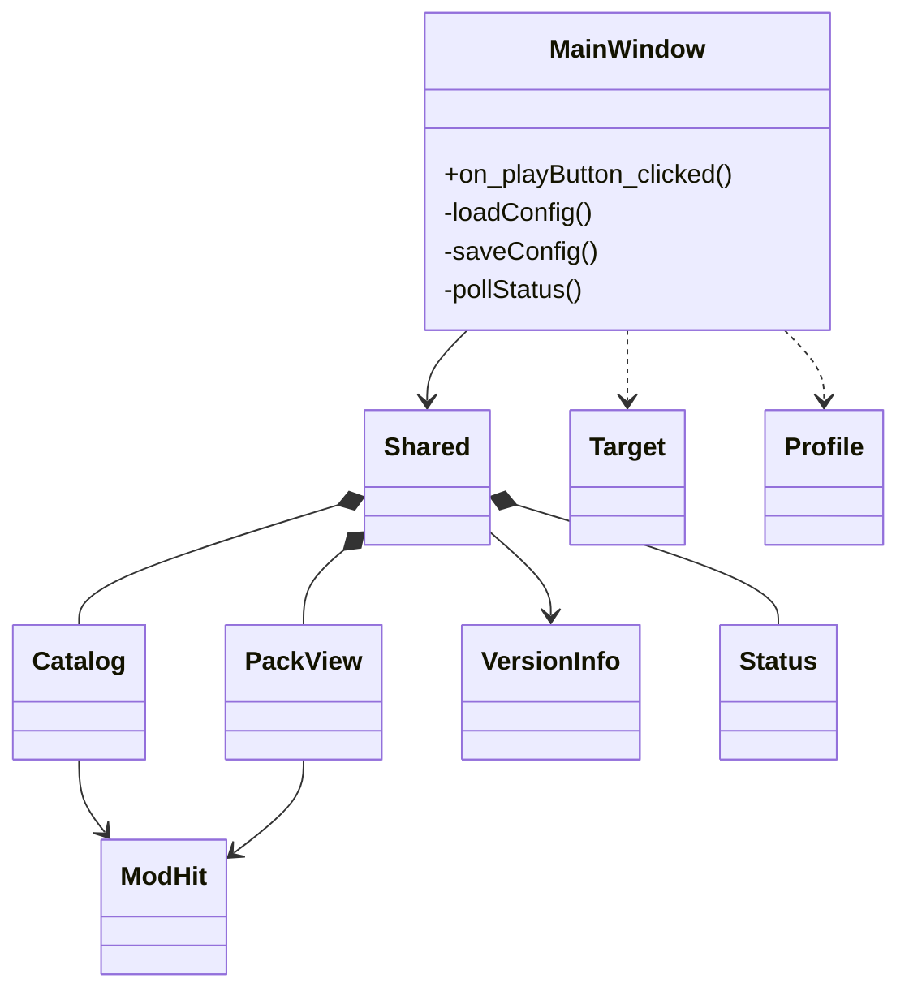
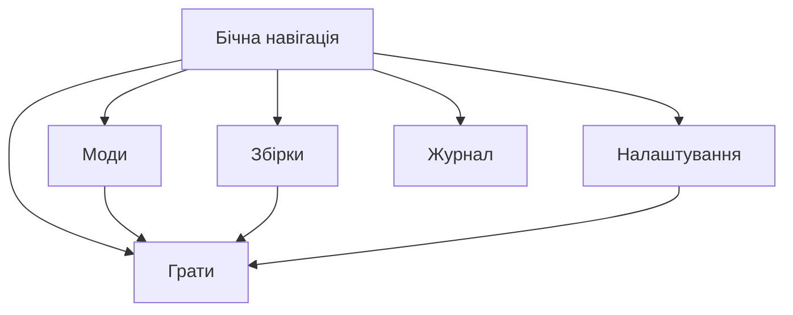
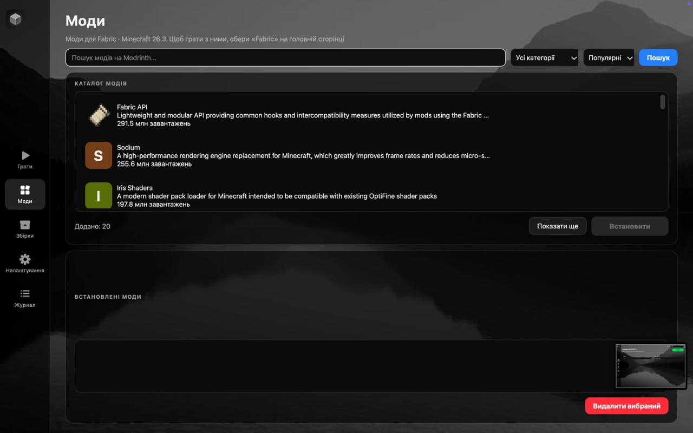
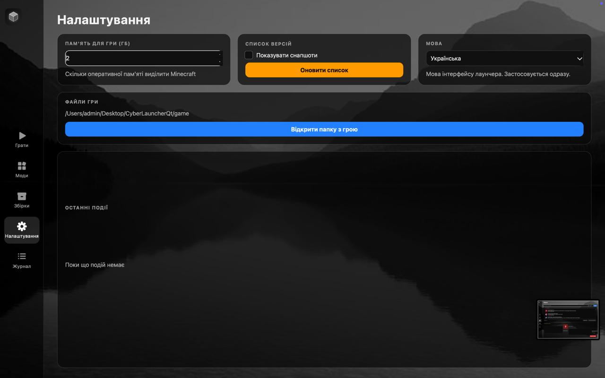
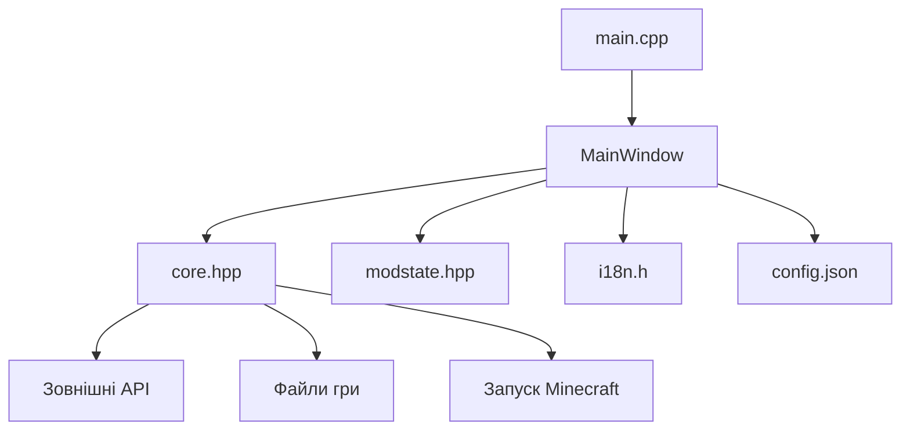

# Практичні роботи №1–20 — CyberLauncher

**Команда:** CyberLeaks  
**Проєкт:** CyberLauncher — лаунчер Minecraft  
**Репозиторій:** https://github.com/DenyRun0/CyberLauncher  
**База аналізу:** main, commit `c623fa1b5cf9f2ce8b6c9cd812ca6cafd63373e2`.


## Практична №1. Вступ до програмної інженерії та формування команди
**Мета:** сформувати Project Vision.

| Учасник | Роль |
|---|---|
| Ружило Денис | Тімлід, програміст |
| Васюхник Кирило | Графічний інтерфейс |
| Загірський Олексій | Тестувальник |
| Гуменюк Владислав | Системний аналітик |
| Книш Микола | Тестувальник |

Програмна інженерія — систематичний підхід до створення, тестування та супроводу ПЗ. Етапи: аналіз, вимоги, проєктування, реалізація, тестування, реліз, супровід.

**Project Vision:** створити безкоштовний лаунчер без реклами для гравців Minecraft, який спрощує вибір версій, запуск гри та встановлення модів і збірок. Цільова аудиторія — новачки та досвідчені гравці. Безпека й зручність є цілями, а не гарантіями. Ліцензійні умови Minecraft мають дотримуватися.

**Висновок:** визначено команду, проблему та бачення продукту.

## Практична №2. Аналіз проблеми, користувачів та предметної області
**Мета:** визначити предметну область і межі системи.

Проблема: складність ручного встановлення модів, налаштування Java та керування версіями; реклама в деяких аналогах. Потреби: простий запуск, пошук сумісних модів, збереження параметрів, зрозумілі помилки.

| Об’єкт | Призначення та зв’язки |
|---|---|
| Локальний профіль | Нікнейм і параметри запуску; не є підтвердженням ліцензії |
| Версія Minecraft | Визначає файли гри та потрібну Java |
| Завантажувач | Vanilla або Fabric; визначає сумісність модів |
| Збірка | Містить версію гри, Fabric і набір модів |
| Мод | Належить до каталогу; встановлюється у відповідну папку |
| Java | Середовище виконання гри |

Сценарії: вибір версії → запуск; пошук мода → встановлення → перегляд або видалення; пошук збірки → встановлення → вибір; зміна RAM → збереження. Межі: Windows і macOS, Minecraft 1.19+ за README, Fabric та Modrinth. Сервери Minecraft, власний магазин і Microsoft-авторизація не підтверджені як реалізовані.

**Висновок:** описано об’єкти, потреби й межі системи.

## Практична №3. Життєвий цикл ПЗ
**Мета:** обрати модель SDLC.

| Модель | Особливість | Обмеження |
|---|---|---|
| Waterfall | Послідовні етапи | Складно змінювати вимоги |
| інкрементна | Поступове додавання функцій | Потрібна інтеграція |
| Спіральна | Аналіз ризиків на кожному циклі | Складніша організація |
| Agile | Гнучке планування і зворотний зв’язок | Потребує координації |

Обрана ітеративно-інкрементна модель: ядро запуску можна перевірити раніше за каталоги модів та оформлення.


Кожна ітерація: планування → проєктування → реалізація → тестування. Microsoft-авторизація залишається можливою окремою ітерацією.

**Висновок:** модель дозволяє поступово розширювати продукт.

## Практична №4. Формування вимог
**Мета:** створити документ вимог.

Користувачі: гравці, новачки, моддери; розробники й тестувальники підтримують продукт.

| ID | User Story / функціональна вимога | Пріоритет | Критерій приймання |
|---|---|---|---|
| US1 | Як гравець, хочу вибрати версію гри | Високий | Вибір відображається на екрані |
| US2 | Як гравець, хочу запустити гру | Високий | За виконаних передумов стартує процес гри |
| US3 | Як гравець, хочу змінити RAM | Високий | Параметр використовується при запуску |
| US4 | Як користувач, хочу зберігати налаштування | Високий | Після перезапуску значення відновлюються |
| US5 | Як гравець, хочу бачити прогрес і помилки | Високий | Статус або повідомлення відображається |
| US6 | Як моддер, хочу знайти та встановити мод | Середній | Сумісний файл з’являється у папці модів |
| US7 | Як гравець, хочу встановити та видалити збірку | Середній | Список профілів оновлюється |
| US8 | Як користувач, хочу змінити мову | Низький | Інтерфейс оновлюється |
| US9 | Як моддер, хочу видалити мод | Середній | Вибраний мод зникає зі списку |

Нефункціональні вимоги: зрозумілий UI, підтримка Windows/macOS, обробка мережевих помилок, перевірка шляхів і джерел завантаження, збереження конфігурації. Цільова вимога до чуйності: інтерфейс не блокується під час мережевих операцій. Повноцінне редагування довільних профілів та Microsoft-авторизація потребують окремої перевірки/реалізації.

**Висновок:** сформовано вимоги та пріоритети.

## Практична №5. User Stories та критерії приймання
**Мета:** деталізувати backlog.

| ID | Передумова | Дія | Очікуваний результат |
|---|---|---|---|
| US1 | Список версій доступний | Вибрати версію | Змінюється вибрана версія |
| US2 | Версія вибрана, є право користування грою | Натиснути «Грати» | Запуск або зрозуміла помилка |
| US3 | Відкриті налаштування | Змінити RAM | Нове допустиме значення збережено |
| US4 | Параметри змінені | Перезапустити лаунчер | Параметри відновлено |
| US5 | Немає мережі або Java | Почати запуск | Статус помилки або автоматичне отримання Java |
| US6 | Вибрано Fabric | Знайти й встановити сумісний мод | Файл і залежності доступні |
| US7 | Є сумісна збірка | Встановити, потім видалити | Профіль додається та видаляється |
| US8 | Відкриті налаштування | Змінити мову | Підписи оновлюються |
| US9 | Мод встановлено | Видалити його | Файл видалено, список оновлено |

**Висновок:** backlog підготовлено до планування й тестування.

## Практична №6. Use Case Diagram
**Мета:** описати взаємодію акторів із системою.

Актори: гравець, сервіси метаданих Minecraft, Modrinth, сервіс Java. Авторизаційний сервер — перспективний актор.



| Use Case | Основний сценарій | Альтернативний сценарій |
|---|---|---|
| Запуск | Вибрати версію, натиснути «Грати», підготувати файли, запустити процес | Помилка мережі/файлів → статус і журнал |
| Встановлення мода | Вибрати Fabric, знайти мод, встановити | Несумісність → повідомлення |
| Налаштування | Відкрити екран, змінити RAM або мову | Некоректне значення не повинно застосовуватись |

**Висновок:** визначено акторів і три основні сценарії.

## Практична №7. Проєктування структури ПЗ
**Мета:** описати класи й компоненти.

Початкова модель команди передбачала Launcher, User, Settings, GameVersion, GameFile, DownloadManager, GameLauncher. У фактичному коді ці обов’язки розподілено між `MainWindow`, структурами та функціями `core`.


`MainWindow` керує UI; `Shared` містить спільний стан; `Catalog` — результати пошуку; `PackView` — склад збірки; `Target` — місце встановлення; `VersionInfo`, `Status`, `ModHit`, `Profile` описують дані ядра. Мережеві операції відокремлені від UI функціями `core.hpp`.

**Висновок:** діаграма відображає реальні типи, а не вигадані класи.

## Практична №8. Проєктування інтерфейсу
**Мета:** описати екрани й навігацію.

| Екран | Елементи |
|---|---|
| Грати | Нікнейм, версія, завантажувач, кнопка запуску |
| Моди | Пошук, категорія, сортування, встановлення та видалення |
| Збірки | Каталог, встановлені збірки, перегляд складу |
| Налаштування | RAM, снапшоти, мова, відкриття папки гри |
| Журнал | Логи та діагностика |


Сценарії: запуск Vanilla; встановлення мода і запуск Fabric; зміна RAM. Інтерфейс реалізовано у Qt Widgets (`mainwindow.ui`, `mainwindow.cpp`), переходи описано схемою вище. 
**Грати**


**Моди**



**Збірки**


**Налаштування**



**Журнал**


**Висновок:** описано інтерфейс і переходи.

## Практична №9. Основи Git та GitHub
**Мета:** організувати контроль версій.

Репозиторій створено; наявні `README.md`, `.gitignore`, гілки `main`, `Denys`. `.gitignore` виключає `build/`, `game/`, `config.json`, `*.user`, `.DS_Store`.

```bash
git --version
git clone https://github.com/DenyRun0/CyberLauncher.git
cd CyberLauncher
git log --oneline
git branch -a
git pull origin main
git switch -c docs-lab-example
# після редагування документації:
git add README.md
git commit -m "Update documentation"
git push -u origin docs-lab-example
```

```text
git version 2.47.3
Cloning into 'work'...
done.
Already up to date.
Switched to a new branch 'demo/negative-tests'
[demo/negative-tests bb56f52] Додано негативні перевірки модуля
 * [new branch]      demo/negative-tests -> demo/negative-tests
branch 'demo/negative-tests' set up to track 'origin/demo/negative-tests'.
bb56f52 Додано негативні перевірки модуля
bb93514 Початковий знімок модуля
```
Команди clone, pull, switch, add, commit, push, log, status і branch виконано успішно;

| Commit | Опис |
|---|---|
| c623fa1 | Лабароторні |
| 225e3a4 | Auto-download Java |
| a1172c2 | Роблю запуск на віндовс і на мак |
| 390459c | Windows і Mac, автоматична збірка |
| 0bdc30a | Змінив інтерфейс добавив можливість завантажувати моди і модмаки |

**Висновок:** наявність репозиторію та історії підтверджено.

## Практична №10. Командна робота з Git та GitHub
Гілки: main, Denys, labs/tests-and-docs, VladislavGumenuk1-patch-1. [PR #4](https://github.com/DenyRun0/CyberLauncher/pull/4) та [PR #5](https://github.com/DenyRun0/CyberLauncher/pull/5) об'єднані з main. 

### Демонстрація merge conflict
Для перевірки конфлікту створено дві гілки `demo/interface` та `demo/mods`. В обох гілках змінено один і той самий рядок у файлі `README.md`. При об'єднанні гілок виник конфлікт.

```text
<<<<<<< HEAD
Опис: Лаунчер Minecraft із простим інтерфейсом
=======
Опис: Лаунчер Minecraft з каталогом модів
>>>>>>> demo/mods
```

Для вирішення конфлікту потрібно об'єднати обидва описи в один та зберегти зміни.
**Висновок:** GitHub-репозиторій із налаштованим командним workflow.

## Практична №11. Архітектура та структура проєкту
**Мета:** визначити структуру проєкту та взаємодію його компонентів.

**1. Структура проєкту**

Основні файли та папки:

```text
CyberLauncher/
├── main.cpp
├── mainwindow.cpp
├── mainwindow.h
├── mainwindow.ui
├── core.hpp
├── modstate.hpp
├── i18n.h
├── resources.qrc
├── icons/
├── include/
├── tests/
├── CMakeLists.txt
├── .github/workflows/
└── README.md
```

**2. Призначення компонентів**

- `main.cpp` — запуск програми.
- `mainwindow.cpp`, `mainwindow.h`, `mainwindow.ui` — робота та вигляд інтерфейсу.
- `core.hpp` — завантаження файлів, встановлення модів і збірок, запуск гри.
- `modstate.hpp` — увімкнення та вимкнення модів.
- `i18n.h` — переклад інтерфейсу.
- `resources.qrc` та `icons/` — зображення та іконки.
- `include/` — підключені бібліотеки.
- `tests/` — тести програми.
- `CMakeLists.txt` та `.github/workflows/` — налаштування збірки та її автоматизація.
- `README.md` — опис проєкту.

**3. Архітектурна схема**



Коли користувач натискає кнопку «Грати», інтерфейс передає вибрані параметри до основної частини програми. Вона завантажує потрібні файли, перевіряє наявність Java та запускає гру. Налаштування зберігаються у файлі `config.json`.

**4. Обґрунтування**

Для розробки обрали C++ та Qt 6, щоб програма могла працювати на Windows і macOS. Інтерфейс та основну логіку розділили, щоб було простіше додавати нові функції та виправляти помилки.

**Висновок:** визначили структуру проєкту, розподілили функції між компонентами та побудували схему їх взаємодії.

## Практична №12. Планування розробки та MVP
**Мета:** визначити мінімальну робочу версію.

**1. Аналіз backlog**

Backlog — це повний список функціоналу, який планується реалізувати.
 Потенційні функції:

  - Вибір версії гри 
  - Вибір завантажувача (Vanilla, без модів)
  - Введення нікнейму користувача
  - Кнопка "ГРАТИ" для запуску гри
  - Відображення статусу (час у грі, остання гра)
  - Меню навігації:
    - Грати (основний екран)
    - Моди (управління модами)
    - Збірки (пакети модів чи конфігурацій)
    - Налаштування (загальні опції, Java, графіка, тощо)
    - Журнал (лог подій і помилок)
  - Прогрес-бар стану завантаження або запуску
  - Збереження і завантаження налаштувань

**2. Визначення MVP**

MVP (Minimum Viable Product) — це мінімально необхідний набір функцій, які потрібно реалізувати, щоб продукт міг працювати та бути корисним.

Обов’язкові функції для MVP:
  - Вибір версії гри
  - Вибір типу завантажувача (напр., Vanilla)
  - Введення нікнейму
  - Кнопка запуску гри ("ГРАТИ"), що реально запускає гру
  - Відображення базового статусу (поточна версія, час гри)
  - Основний UI для навігації (екран “Грати”)

Цей набір дозволить запустити гру і мати базову взаємодію користувача з програмою.


**3. Додаткові функції (поза MVP)**

Функції, які можна реалізувати після основи:

  - Управління модами (Завантаження, увімкнення/вимкнення)
  - Збірки (управління пакетами конфігурацій і модів)
  - Розширені налаштування (Java, графіка, оновлення)
  - Журнал подій/помилок
  - Прогрес-бар завантаження й інформування користувача
  - Статистика і історія ігор (час у грі, остання сесія)

**4. Розбиття User Stories на задачі**

Приклад User Story:  
Як користувач, я хочу обрати версію гри, щоб грати саме в потрібну версію.

Задачі:  
  - Розробити інтерфейс вибору версії  
  - Зберігати вибрану версію у налаштуваннях  
  - Забезпечити передачу вибраної версії до процесу запуску гри  

Інші User Stories можна побудувати й для кожної функції.

**5. Порядок виконання**

  1. Створення базового UI з можливістю вводити нікнейм, вибирати версію і тип завантажувача.  
  2. Реалізація кнопки “ГРАЙ” з базовим запуском гри.  
  3. Відображення основної інформації про версію і час у грі.  
  4. Збереження і завантаження вибраних налаштувань.  
  5. Наступним етапом — реалізація модулів для модів і збірок (позапланово для MVP).  
  6. Далі — меню налаштувань та журналів.  

 **6. План першої ітерації**
**Мета**: Реалізувати базовий запуск гри із мінімальним UI (MVP)

**Задачі**:

  - Створити головний екран з полями для нікнейму, вибору версії і завантажувача.  
  - Реалізувати кнопку запуску з базовою логікою.  
  - Відобразити базову інформацію (версія, час, статус гри).  
  - Впровадити просте збереження обраних налаштувань.  
  - Провести тестування базової функціональності.


## Практична №13. Початок розробки
**Мета:** перейти від проєктування до практичної реалізації програмного продукту, проаналізувати реалізацію першої User Story, дослідити взаємодію основних компонентів лаунчера та визначити критерії перевірки його функціональності.

US1 реалізована у поточному коді: `core::fetchVersions()` отримує список версій, `MainWindow::loadVersionsAsync()` запускає фонове отримання, `fillVersionBox()` заповнює список, `currentVersionId()` повертає вибір. `pollStatus()` оновлює UI. Передбачено кеш manifest.

Алгоритм роботи US1

  1.Користувач запускає CyberLauncher.
  
  2.Програма ініціалізує головне вікно.
  
  3.Запускається фонове отримання списку версій Minecraft.
  
  4.Отримані дані обробляються та передаються до графічного інтерфейсу.
  
  5.Користувач переглядає доступні версії та вибирає потрібну.
  
  6.Вибрана версія використовується для подальшої підготовки запуску гри.
  
  7.Налаштування користувача зберігаються для наступного запуску програми.
  

Для перевірки US1 передбачено такі дії:

  1.Запустити програму та дочекатися завантаження списку версій.
  
  2.Перевірити відображення доступних релізів.
  
  3.Увімкнути та вимкнути показ Snapshot-версій.
  
  4.Вибрати потрібну версію Minecraft.
  
  5.Перевірити повторне оновлення списку версій.
  
  6.Перевірити збереження вибору після перезапуску програми.
  
  7.Перевірити використання кешованого manifest.

Фактичний запуск програми та виконання тестів не проводилися. Реалізацію функціональності підтверджено статичним аналізом вихідного коду. Історія Git підтверджує наявність відповідної функціональності, але не дозволяє однозначно встановити окремий commit першої User Story. Інструкції зі збирання проєкту наведені у README.

**Висновок:** під час виконання практичної роботи було проаналізовано початкову реалізацію CyberLauncher та досліджено першу User Story, пов'язану з отриманням і вибором версій Minecraft. Розглянуто фонове завантаження даних, використання локального кешу, підтримку Snapshot-версій, оновлення списку та збереження налаштувань. Визначено основні етапи роботи функціональності та підготовлено сценарії її перевірки.

## Практична №14. Реалізація функціональності та інтеграція
**Мета:** проаналізувати реалізацію трьох історій.

| Історія | Реалізація | Локальна перевірка (план) |
|---|---|---|
| US2 | `on_playButton_clicked`, `installAndRun`, `ensureJava`, `spawnGame` | Запустити сумісну версію |
| US6 | `searchProjects`, `installMod`, `on_modInstallButton_clicked` | Встановити сумісний мод |
| US7 | `installModpack`, `listProfiles`, `deleteProfile` | Встановити та видалити збірку |

Commit `0bdc30a` описує додавання модів і збірок, `225e3a4` — автоматичне завантаження Java. Інтеграція функцій видима в main. Інтеграцію підтверджено PR #4 та #5, успішною збіркою [GitHub Actions](https://github.com/DenyRun0/CyberLauncher/actions/runs/45637979290). Локальні результати наведено в №15 за повідомленням учасника.

**Висновок:** функціональний прототип наявний у коді; працездатність потребує запуску.


## Практична №15. Основи тестування програмного забезпечення
Мета: визначити позитивні й негативні сценарії та зафіксувати ручну перевірку.

| ID | Дія | Очікуваний результат | Результат за повідомленням учасника |
|---|---|---|---|
| TC-01 | Запуск лаунчера | Вікно відкривається | PASS |
| TC-02 | Вибір версії | Список доступний | PASS |
| TC-03 | Запуск Vanilla | Гра запускається | PASS |
| TC-04 | Запуск Fabric | Гра запускається | PASS |
| TC-05 | Пошук модів | Результати відображаються | PASS |
| TC-06 | Встановлення мода | Мод у списку | PASS |
| TC-07 | Встановлення збірки | Збірка доступна | PASS |
| TC-08 | Зміна RAM | Налаштування зберігається | PASS |
| TC-09 | Зміна мови | Інтерфейс оновлюється | PASS |
| TC-10 | Відсутність інтернету | Помилка обробляється без аварійного завершення | PASS |


| ID | Додатковий сценарій | Очікування | Результат |
|---|---|---|---|
| TC-11 | Натиснути кнопку перемикання мода | Кнопка працює | PASS (учасник) |
| TC-12 | Запустити v3.1-build-8 на Intel Mac | Лаунчер відкривається | PASS (учасник) |

П'ять додаткових негативних сценаріїв файлового модуля виконано програмно (№16, [протокол](docs/VERIFICATION.md)). Перевірка GUI для порожнього/некоректного нікнейму, несумісного мода, недоступної версії та повторного запуску не виконана в цьому середовищі; окремо перевіряється статистика. Це не результати ручного тестування.

## Практична №16. Автоматизоване тестування
Реалізовано C++-тести у [tests/core_tests.cpp](tests/core_tests.cpp), підключені через CMake/CTest. Замість демонстраційних Qt Test використано фактичні функції ядра.

| № | Перевірка | Очікування | CI |
|---|---|---|---|
| 1 | urlEncode("abc") | abc | PASS |
| 2 | urlEncode("a b") | a%20b | PASS |
| 3 | mavenPath | org/example/demo/1.0/demo-1.0.jar | PASS |
| 4 | substitute | Player | PASS |
| 5 | allowedDownloadUrl | Відхилення недовіреного HTTP | PASS |
| 6 | toggle | Вимкнення JAR | PASS |
| 7 | toggle | Повторне ввімкнення JAR | PASS |
| 8 | toggle | Відхилення колізії | PASS |

Команди: cmake --build build --config Release; ctest --test-dir build -C Release --output-on-failure.
[Успішний запуск CI](https://github.com/DenyRun0/CyberLauncher/actions/runs/45637979290): Windows, macOS Intel, macOS ARM64 і публікація релізу. Вісім перевірок у первинному тестовому виконуваному файлі; GUI цими тестами не перевірено.


## Практична №17. Управління програмним проєктом
Backlog, пріоритети, планові відповідальні, sprint і поточні статуси наведені у - [Kanban-дошка — GitHub Projects](https://github.com/users/DenyRun0/projects/14).

## Практична №18. Пошук, аналіз та виправлення помилок
| Issue | Проблема | Пріоритет | Виправлення / перевірка |
|---|---|---|---|
| [#1](https://github.com/DenyRun0/CyberLauncher/issues/1) | Інструкція Java | Середній | README уточнено; запуск без Java ще не підтверджено |
| [#2](https://github.com/DenyRun0/CyberLauncher/issues/2) | Інструкція macOS не відповідала архіву | Високий | README оновлено; архіви Intel/ARM64 опубліковано |
| [#3](https://github.com/DenyRun0/CyberLauncher/issues/3) | Відсутність CTest | Середній | CTest додано, CI успішний |

Усі три Issues закрито. Це три проблеми документації/конфігурації, не три runtime-дефекти. Додатково виправлено порядок аргументів lipo та підписування macOS-пакета. [Реліз v3.1-build-8](https://github.com/DenyRun0/CyberLauncher/releases/tag/v3.1-build-8) і [успішна збірка](https://github.com/DenyRun0/CyberLauncher/actions/runs/45637979290) підтверджують пакування; фактичний запуск на Intel підтвердив учасник 25.11.2026. Перевірка чистого середовища Java та Windows залишається у #7.

## Практична №19. Зміна вимог та супровід ПЗ
US10: вимикання та ввімкнення встановленого мода без видалення. Змінено mainwindow.ui, mainwindow.cpp/h, modstate.hpp, tests/core_tests.cpp і README. PR #4 об'єднано. Файл .jar перейменовується на .jar.disabled і назад; колізія не перезаписує файл. Три автоматизовані перевірки перемикання пройдено. містить критерії ручного приймання та повторної перевірки Fabric. Роботу кнопки перемикання модів підтвердив учасник Олексій Загірський. Окремо залишаються перевірки після перезапуску, блокування під час гри та повторний запуск Fabric.

## Практична №20. Документування та презентація продукту
**Мета:** підготувати документацію і демонстрацію.

### User Manual
CyberLauncher — настільний лаунчер Minecraft з підтримкою Vanilla, Fabric і каталогу Modrinth. Сторінка релізів: https://github.com/DenyRun0/CyberLauncher/releases . Для Windows розпакувати відповідний архів і відкрити `CyberLauncher.exe`. Для macOS — розпакувати архів і відкрити `.app`, якщо він сумісний із системою та перевірено його походження. Не обходити системні попередження безпеки. Реліз v3.1-build-8 підтверджено: Windows, macOS Intel та Apple Silicon. Ціль macOS 12+.

Збірка з коду: потрібні CMake 3.20+, Qt6 Widgets, libcurl, C++17. На macOS після встановлення залежностей:

```bash
cmake -B build -DCMAKE_PREFIX_PATH="$(brew --prefix qt)"
cmake --build build
open build/CyberLauncher.app
```

На Windows (Visual Studio, Qt6 і vcpkg):

```powershell
vcpkg install curl:x64-windows
cmake -B build -DCMAKE_TOOLCHAIN_FILE="<vcpkg>/scripts/buildsystems/vcpkg.cmake" -DCMAKE_PREFIX_PATH="<Qt>"
cmake --build build --config Release
```

Замінити `<vcpkg>` і `<Qt>` фактичними шляхами. Запустити `build/Release/CyberLauncher.exe`.

Користування: вибрати версію та завантажувач, налаштувати RAM, натиснути «Грати» за наявності права користування грою. Для модів перейти до «Моди», знайти сумісний проєкт і встановити. Для збірок — «Збірки», пошук, встановлення та вибір профілю. При проблемах переглянути «Журнал». Java підбирається ядром; автоматичне завантаження передбачене кодом. Дані Windows — `game` поруч з exe; macOS — `~/Library/Application Support/CyberLauncher/game` за README.


README і структура перевірені. Реліз v3.1-build-8 опубліковано, [User Manual](docs/USER_MANUAL.md) підготовлені. Презентацію PowerPoint підготовлено окремим файлом.

**Висновок:** підготовлено документацію і приклади використання.

## Джерела
- [Вихідний код за перевіреним commit](https://github.com/DenyRun0/CyberLauncher/tree/c623fa1b5cf9f2ce8b6c9cd812ca6cafd63373e2).
- [Ядро](https://github.com/DenyRun0/CyberLauncher/blob/main/core.hpp), (https://github.com/DenyRun0/CyberLauncher/blob/main/mainwindow.cpp), [CMake](https://github.com/DenyRun0/CyberLauncher/blob/main/CMakeLists.txt), [CI][гілки](https://github.com/DenyRun0/CyberLauncher/branches), [Issues](https://github.com/DenyRun0/CyberLauncher/issues), [Pull Requests](https://github.com/DenyRun0/CyberLauncher/pulls).
