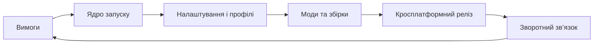
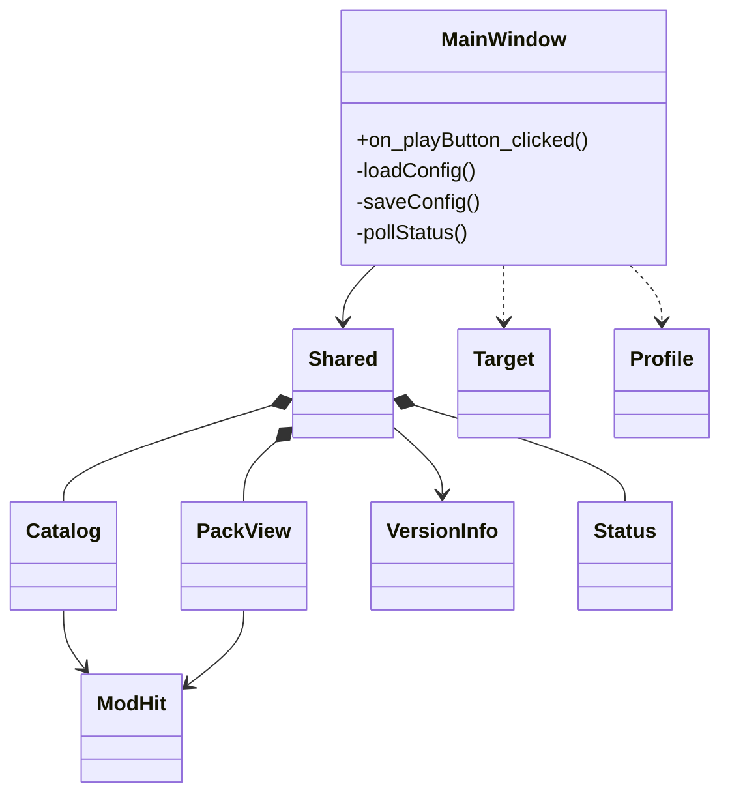
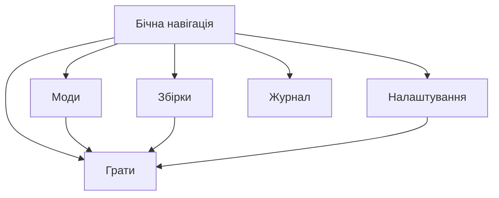
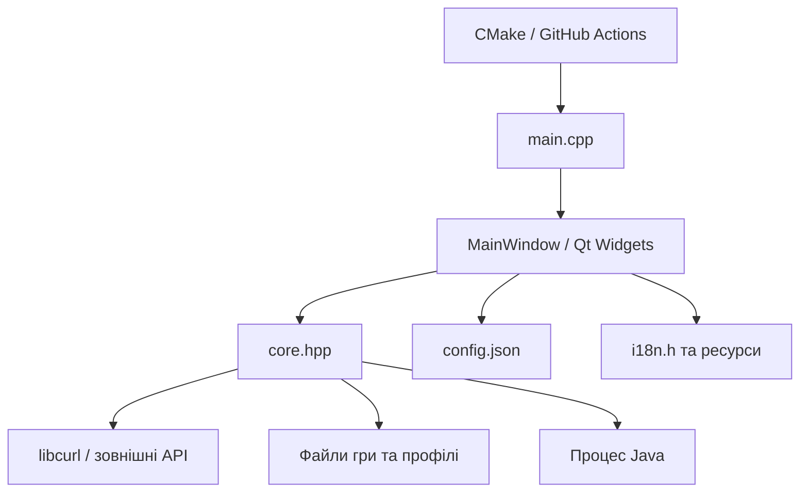

# Практичні роботи №1–20 — CyberLauncher

**Команда:** CyberLeaks  
**Проєкт:** CyberLauncher — лаунчер Minecraft  
**Репозиторій:** https://github.com/DenyRun0/CyberLauncher  
**База аналізу:** main, commit `c623fa1b5cf9f2ce8b6c9cd812ca6cafd63373e2`.

Документ поєднує надані напрацювання та аналіз вихідного коду. Запропоновані тести, задачі й зміни не є підтвердженням їх фактичного виконання. Репозиторій не змінювався.

## Практична №1. Вступ до програмної інженерії та формування команди
**Мета:** сформувати Project Vision.

| Учасник | Роль |
|---|---|
| Ружило Денис | Тімлід, програміст |
| Васюхник Кирило | Графічний інтерфейс |
| Загірський Олексій | Тестувальник |
| Гоменюк Владислав | Системний аналітик |

Програмна інженерія — систематичний підхід до створення, тестування та супроводу ПЗ. Етапи: аналіз, вимоги, проєктування, реалізація, тестування, реліз, супровід.

**Project Vision:** створити безкоштовний лаунчер без реклами для гравців Minecraft, який спрощує вибір версій, запуск гри та встановлення модів і збірок. Цільова аудиторія — новачки та досвідчені гравці. Безпека й зручність є цілями, а не гарантіями. Ліцензійні умови Minecraft мають дотримуватися.

**Висновок:** визначено команду, проблему та бачення продукту.

## Практична №2. Аналіз проблеми, користувачів та предметної області
**Мета:** визначити предметну область і межі системи.

Проблема: складність ручного встановлення модів, налаштування Java та керування версіями; реклама в деяких аналогах. Потреби: простий запуск, пошук сумісних модів, збереження параметрів, зрозумілі помилки.

| Об’єкт | Призначення та зв’язки |
|---|---|
| Локальний профіль | Нікнейм і параметри запуску; не є підтвердженням ліцензії |
| Версія Minecraft | Визначає файли гри та потрібну Java |
| Завантажувач | Vanilla або Fabric; визначає сумісність модів |
| Збірка | Містить версію гри, Fabric і набір модів |
| Мод | Належить до каталогу; встановлюється у відповідну папку |
| Java | Середовище виконання гри |

Сценарії: вибір версії → запуск; пошук мода → встановлення → перегляд або видалення; пошук збірки → встановлення → вибір; зміна RAM → збереження. Межі: Windows і macOS, Minecraft 1.19+ за README, Fabric та Modrinth. Сервери Minecraft, власний магазин і Microsoft-авторизація не підтверджені як реалізовані.

**Висновок:** описано об’єкти, потреби й межі системи.

## Практична №3. Життєвий цикл ПЗ
**Мета:** обрати модель SDLC.

| Модель | Особливість | Обмеження |
|---|---|---|
| Waterfall | Послідовні етапи | Складно змінювати вимоги |
| Ітеративно-інкрементна | Поступове додавання функцій | Потрібна інтеграція |
| Спіральна | Аналіз ризиків на кожному циклі | Складніша організація |
| Agile | Гнучке планування і зворотний зв’язок | Потребує координації |

Обрана ітеративно-інкрементна модель: ядро запуску можна перевірити раніше за каталоги модів та оформлення.


Кожна ітерація: планування → проєктування → реалізація → тестування. Microsoft-авторизація залишається можливою окремою ітерацією.

**Висновок:** модель дозволяє поступово розширювати продукт.

## Практична №4. Формування вимог
**Мета:** створити документ вимог.

Користувачі: гравці, новачки, моддери; розробники й тестувальники підтримують продукт.

| ID | User Story / функціональна вимога | Пріоритет | Критерій приймання |
|---|---|---|---|
| US1 | Як гравець, хочу вибрати версію гри | Високий | Вибір відображається на екрані |
| US2 | Як гравець, хочу запустити гру | Високий | За виконаних передумов стартує процес гри |
| US3 | Як гравець, хочу змінити RAM | Високий | Параметр використовується при запуску |
| US4 | Як користувач, хочу зберігати налаштування | Високий | Після перезапуску значення відновлюються |
| US5 | Як гравець, хочу бачити прогрес і помилки | Високий | Статус або повідомлення відображається |
| US6 | Як моддер, хочу знайти та встановити мод | Середній | Сумісний файл з’являється у папці модів |
| US7 | Як гравець, хочу встановити та видалити збірку | Середній | Список профілів оновлюється |
| US8 | Як користувач, хочу змінити мову | Низький | Інтерфейс оновлюється |
| US9 | Як моддер, хочу видалити мод | Середній | Вибраний мод зникає зі списку |

Нефункціональні вимоги: зрозумілий UI, підтримка Windows/macOS, обробка мережевих помилок, перевірка шляхів і джерел завантаження, збереження конфігурації. Цільова вимога до чуйності: інтерфейс не блокується під час мережевих операцій. Повноцінне редагування довільних профілів та Microsoft-авторизація потребують окремої перевірки/реалізації.

**Висновок:** сформовано вимоги та пріоритети.

## Практична №5. User Stories та критерії приймання
**Мета:** деталізувати backlog.

| ID | Передумова | Дія | Очікуваний результат |
|---|---|---|---|
| US1 | Список версій доступний | Вибрати версію | Змінюється вибрана версія |
| US2 | Версія вибрана, є право користування грою | Натиснути «Грати» | Запуск або зрозуміла помилка |
| US3 | Відкриті налаштування | Змінити RAM | Нове допустиме значення збережено |
| US4 | Параметри змінені | Перезапустити лаунчер | Параметри відновлено |
| US5 | Немає мережі або Java | Почати запуск | Статус помилки або автоматичне отримання Java |
| US6 | Вибрано Fabric | Знайти й встановити сумісний мод | Файл і залежності доступні |
| US7 | Є сумісна збірка | Встановити, потім видалити | Профіль додається та видаляється |
| US8 | Відкриті налаштування | Змінити мову | Підписи оновлюються |
| US9 | Мод встановлено | Видалити його | Файл видалено, список оновлено |

Додаткова історія з початкового документа: вимикання JAR-модів без видалення — запланована, реалізацію не підтверджено. Історії містять роль, дію і результат; критерії описують спостережувану поведінку.

**Висновок:** backlog підготовлено до планування й тестування.

## Практична №6. Use Case Diagram
**Мета:** описати взаємодію акторів із системою.

Актори: гравець, сервіси метаданих Minecraft, Modrinth, сервіс Java. Авторизаційний сервер — перспективний актор.


| Use Case | Основний сценарій | Альтернативний сценарій |
|---|---|---|
| Запуск | Вибрати версію, натиснути «Грати», підготувати файли, запустити процес | Помилка мережі/файлів → статус і журнал |
| Встановлення мода | Вибрати Fabric, знайти мод, встановити | Несумісність → повідомлення |
| Налаштування | Відкрити екран, змінити RAM або мову | Некоректне значення не повинно застосовуватись |

**Висновок:** визначено акторів і три основні сценарії.

## Практична №7. Проєктування структури ПЗ
**Мета:** описати класи й компоненти.

Початкова модель команди передбачала Launcher, User, Settings, GameVersion, GameFile, DownloadManager, GameLauncher. У фактичному коді ці обов’язки розподілено між `MainWindow`, структурами та функціями `core`.


`MainWindow` керує UI; `Shared` містить спільний стан; `Catalog` — результати пошуку; `PackView` — склад збірки; `Target` — місце встановлення; `VersionInfo`, `Status`, `ModHit`, `Profile` описують дані ядра. Мережеві операції відокремлені від UI функціями `core.hpp`.

**Висновок:** діаграма відображає реальні типи, а не вигадані класи.

## Практична №8. Проєктування інтерфейсу
**Мета:** описати екрани й навігацію.

| Екран | Елементи |
|---|---|
| Грати | Нікнейм, версія, завантажувач, кнопка запуску |
| Моди | Пошук, категорія, сортування, встановлення та видалення |
| Збірки | Каталог, встановлені збірки, перегляд складу |
| Налаштування | RAM, снапшоти, мова, відкриття папки гри |
| Журнал | Логи та діагностика |


Сценарії: запуск Vanilla; встановлення мода і запуск Fabric; зміна RAM і повернення на головний екран. Екрани підтверджено скриншотами у наданому DOCX та `mainwindow.ui`/`mainwindow.cpp`. Для Figma необхідно створити п’ять фреймів і зв’язати їх кнопками бічного меню. Посилання на Figma не надано; цей опис не замінює інтерактивний прототип.

**Висновок:** описано інтерфейс і переходи.

## Практична №9. Основи Git та GitHub
**Мета:** організувати контроль версій.

Репозиторій створено; наявні `README.md`, `.gitignore`, гілки `main`, `Denys`. `.gitignore` виключає `build/`, `game/`, `config.json`, `*.user`, `.DS_Store`.

```bash
git --version
git clone https://github.com/DenyRun0/CyberLauncher.git
cd CyberLauncher
git log --oneline
git branch -a
git pull origin main
git switch -c docs-lab-example
# після редагування документації:
git add README.md
git commit -m "Update documentation"
git push -u origin docs-lab-example
```
Команди наведено як інструкцію, а не журнал виконання.

| Commit | Опис |
|---|---|
| c623fa1 | Лабароторні |
| 225e3a4 | Auto-download Java |
| a1172c2 | Роблю запуск на віндовс і на мак |
| 390459c | Windows і Mac, автоматична збірка |
| 0bdc30a | Змінив інтерфейс добавив можливість завантажувати моди і модмаки |

**Висновок:** наявність репозиторію та історії підтверджено.

## Практична №10. Командна робота з Git та GitHub
**Мета:** організувати командний workflow.

Фактично наявні `main` та `Denys`. Pull Requests у доступному списку відсутні. Пропоновані гілки: `feature/ui` (Кирило), `test/cases` (Олексій), `docs/requirements` (Владислав); Денис інтегрує зміни.

Порядок: створити гілку від main → змінити відповідний файл → commit → push → Pull Request → review → виправлення → merge. Приклад навчального конфлікту: дві гілки змінюють один рядок README. Після `git merge` залишити узгоджений текст, прибрати маркери конфлікту, виконати `git add README.md` і `git commit`.

Критерії review: відповідність вимогам, відсутність секретів, читабельність, перевірка збірки. Для завершення роботи потрібні реальні PR, review та підтвердження merge; їх не створювали в межах цього звіту.

**Висновок:** розроблено командний процес; частина практичних дій ще потребує виконання.

## Практична №11. Архітектура та структура проєкту
**Мета:** визначити модулі та їх взаємодію.

```text
CyberLauncher/
├── main.cpp
├── mainwindow.cpp / mainwindow.h / mainwindow.ui
├── core.hpp
├── i18n.h
├── resources.qrc
├── icons/ та include/nlohmann/
├── CMakeLists.txt
├── .github/workflows/build.yml
├── run-mac.command / run-windows.bat
├── README.md
└── Laboratory/
```


Технології: C++17, Qt6 Widgets, libcurl, nlohmann/json, CMake 3.20+. `core.hpp` об’єднує мережеві, файлові й ігрові операції; `MainWindow` координує їх через фонові потоки, атомарні змінні та mutex. Поділ UI і ядра спрощує супровід, хоча великий заголовок ядра доцільно згодом розділити.

**Висновок:** описано фактичну архітектуру.

## Практична №12. Планування розробки та MVP
**Мета:** визначити мінімальну робочу версію.

MVP: список версій, вибір Vanilla, локальні налаштування, підготовка Java і файлів, запуск та журнал помилок. Додаткові функції: Fabric, Modrinth, збірки, локалізація, статистика часу.

| Порядок | Історія | Задачі | Відповідальний (план) |
|---|---|---|---|
| 1 | US1 | Отримати manifest, заповнити список | Денис |
| 2 | US3–4 | Створити UI RAM, JSON-конфігурацію | Кирило, Денис |
| 3 | US2 | Підготувати файли та Java, запустити процес | Денис |
| 4 | US5 | Відобразити прогрес і журнал | Кирило |
| 5 | US1–5 | Перевірити критерії приймання | Олексій |
| 6 | US1–5 | Уточнити вимоги й документацію | Владислав |

Перша ітерація завершується демонстрацією запуску та відновлення налаштувань. Це реконструйований план, а не історичний запис спринту.

**Висновок:** визначено MVP і порядок реалізації.

## Практична №13. Початок розробки
**Мета:** описати першу реалізовану історію.

US1 реалізована у поточному коді: `core::fetchVersions()` отримує список версій, `MainWindow::loadVersionsAsync()` запускає фонове отримання, `fillVersionBox()` заповнює список, `currentVersionId()` повертає вибір. `pollStatus()` оновлює UI. Передбачено кеш manifest.

Перевірка: запустити програму, дочекатися списку, вибрати реліз, увімкнути показ снапшотів, перевірити вибір після перезапуску. Фактичний запуск не проводився. Історія Git підтверджує наявність коду, але не дозволяє встановити окремий commit першої User Story. README вже містить інструкції збірки.

**Висновок:** реалізацію US1 підтверджено статичним аналізом.

## Практична №14. Реалізація функціональності та інтеграція
**Мета:** проаналізувати реалізацію трьох історій.

| Історія | Реалізація | Локальна перевірка (план) |
|---|---|---|
| US2 | `on_playButton_clicked`, `installAndRun`, `ensureJava`, `spawnGame` | Запустити сумісну версію |
| US6 | `searchProjects`, `installMod`, `on_modInstallButton_clicked` | Встановити сумісний мод |
| US7 | `installModpack`, `listProfiles`, `deleteProfile` | Встановити та видалити збірку |

Commit `0bdc30a` описує додавання модів і збірок, `225e3a4` — автоматичне завантаження Java. Інтеграція функцій видима в main. PR та результати локального тестування не підтверджені. Для командної інтеграції застосовується процес №10, після merge потрібно повторити тест-кейси №15.

**Висновок:** функціональний прототип наявний у коді; працездатність потребує запуску.

## Практична №15. Основи тестування ПЗ
**Мета:** сформувати позитивні та негативні тест-кейси.

| ID | Передумова / дія | Очікуваний результат | Фактичний результат |
|---|---|---|---|
| TC01 | Є мережа; відкрити список версій | Список завантажено | Не запускалось |
| TC02 | Вибрати реліз і запустити за виконаних передумов | Старт процесу гри | Не запускалось |
| TC03 | Змінити RAM, перезапустити | Значення відновлено | Не запускалось |
| TC04 | Fabric; знайти сумісний мод | Результати пошуку | Не запускалось |
| TC05 | Встановити і видалити мод | Список і файли оновлено | Не запускалось |
| TC06 | Встановити сумісну збірку | Профіль доступний | Не запускалось |
| TC07 | Вимкнути мережу без кешу; оновити версії | Зрозуміла помилка | Не запускалось |
| TC08 | Вибрати несумісний мод | Встановлення відхилено | Не запускалось |
| TC09 | Відсутня потрібна Java | Автозавантаження або повідомлення | Не запускалось |
| TC10 | Змінити мову | Підписи оновлено | Не запускалось |

Ручне тестування слід провести на Windows і macOS, зафіксувавши версію ОС, commit, фактичний результат та Pass/Fail. Не використовувати особисті дані в логах звіту.

**Висновок:** підготовлено десять тест-кейсів; результати не вигадані.

## Практична №16. Автоматизоване тестування
**Мета:** підготувати п’ять простих тестів ядра.

У дереві main окремого тестового каталогу не виявлено. Нижче — запропонований файл `tests/core_tests.cpp`, який необхідно додати й перевірити в середовищі проєкту.

```cpp
#include "../core.hpp"
#include <iostream>
#include <stdexcept>
void check(bool ok, const char* name) {
    if (!ok) throw std::runtime_error(name);
    std::cout << "PASS: " << name << '\n';
}
int main() {
    check(core::urlEncode("abc") == "abc", "plain URL text");
    check(core::urlEncode("a b") == "a%20b", "URL space");
    check(core::mavenPath("org.example:demo:1.0") ==
          "org/example/demo/1.0/demo-1.0.jar", "Maven path");
    check(core::substitute("${name}", {{"name", "Player"}}) ==
          "Player", "known placeholder");
    check(!core::allowedDownloadUrl("http://example.invalid/a"),
          "reject untrusted HTTP URL");
}
```
Додати до CMake (після основних налаштувань):

```cmake
include(CTest)
if(BUILD_TESTING)
  add_executable(core_tests tests/core_tests.cpp)
  target_include_directories(core_tests PRIVATE include)
  target_link_libraries(core_tests PRIVATE CURL::libcurl)
  if(nlohmann_json_FOUND)
    target_link_libraries(core_tests PRIVATE nlohmann_json::nlohmann_json)
  endif()
  add_test(NAME core_tests COMMAND core_tests)
endif()
```
Запуск: `cmake --build build --config Release`, потім `ctest --test-dir build -C Release --output-on-failure`. Тести охоплюють позитивні та негативні випадки; компіляція і виконання не перевірені. Якщо тест не проходить, спочатку звірити очікування з контрактом функції, потім виправити дефект і повторити запуск.

**Висновок:** підготовлено код тестів і спосіб інтеграції.

## Практична №17. Управління програмним проєктом
**Мета:** сформувати backlog, Kanban і sprint.

| Задача | Пріоритет | Виконавець (план) | Статус за доступними даними |
|---|---|---|---|
| US1–2 Версії та запуск | Високий | Денис | Код наявний |
| US3–5 Налаштування та журнал | Високий | Денис, Кирило | Код наявний |
| US6–9 Моди, збірки, мова | Середній | Денис, Кирило | Код наявний |
| TC01–10 Ручні тести | Високий | Олексій | Backlog |
| Автоматизовані тести | Високий | Олексій, Денис | Backlog |
| Документація і Figma | Середній | Владислав, Кирило | Backlog |

Kanban: Backlog → To Do → In Progress → Review → Done. Наявність коду не означає Done без приймання. Запропонований sprint — 7 днів: дні 1–2 уточнення вимог і тестів, 3–4 перевірка запуску й модів, 5 виправлення, 6 повторне тестування, 7 демонстрація. Дошку можна перенести в GitHub Projects; її створення та фактичний рух карток не підтверджені.

**Висновок:** підготовлено план управління.

## Практична №18. Пошук, аналіз та виправлення помилок
**Мета:** сформувати три задачі на основі статичного аналізу.

| Кандидат Issue | Умови / проблема | Пріоритет | Запропоноване виправлення та перевірка |
|---|---|---|---|
| BUG-01 | README вимагає встановлену Java, хоча `ensureJava` передбачає автозавантаження | Середній | Уточнити README; перевірити запуск без Java |
| BUG-02 | README пропонує `run-mac.command`, але workflow пакує лише `.app` | Високий | Узгодити інструкцію з архівом; перевірити склад релізу |
| BUG-03 | CMake не містить цілі автоматизованих тестів | Середній | Додати CTest із №16; перевірити успішний запуск |

Це підтверджені розбіжності документації/конфігурації, а не три відтворені runtime-дефекти. Для кожної задачі створити Issue з описом, очікуванням, фактом і критерієм закриття; після виправлення провести повторну перевірку та закрити Issue. Список Issues репозиторію порожній; виправлення і закриття не виконані.

**Висновок:** визначено три конкретні проблеми та план усунення.

## Практична №19. Зміна вимог та супровід ПЗ
**Мета:** спланувати зміну продукту.

Нова запропонована вимога US10: як гравець, хочу вимикати та повторно вмикати встановлений мод без повторного завантаження. Пріоритет середній. Вплив: `mainwindow.ui` — кнопка; `mainwindow.h/.cpp` — обробник і список; файлові операції ядра — безпечне перейменування `.jar` ↔ `.jar.disabled` у межах папки модів. Не дозволяти перезапис існуючого файла; не змінювати моди під час гри.

Критерії: вимкнений мод не завантажується Fabric, повторне ввімкнення відновлює файл, колізія імен дає повідомлення, стан видно після перезапуску. Додати задачу до backlog, реалізувати в окремій гілці, перевірити ці чотири сценарії та повторити TC02, TC04–06. Оновити User Manual. Реалізацію нової вимоги не внесено до репозиторію.

**Висновок:** проаналізовано вплив зміни та підготовлено план супроводу.

## Практична №20. Документування та презентація продукту
**Мета:** підготувати документацію і демонстрацію.

### User Manual
CyberLauncher — настільний лаунчер Minecraft з підтримкою Vanilla, Fabric і каталогу Modrinth. Сторінка релізів: https://github.com/DenyRun0/CyberLauncher/releases . Для Windows розпакувати відповідний архів і відкрити `CyberLauncher.exe`. Для macOS — розпакувати архів і відкрити `.app`, якщо він сумісний із системою та перевірено його походження. Не обходити системні попередження безпеки. Наявність конкретного релізу не перевірялась.

Збірка з коду: потрібні CMake 3.20+, Qt6 Widgets, libcurl, C++17. На macOS після встановлення залежностей:

```bash
cmake -B build -DCMAKE_PREFIX_PATH="$(brew --prefix qt)"
cmake --build build
open build/CyberLauncher.app
```

На Windows (Visual Studio, Qt6 і vcpkg):

```powershell
vcpkg install curl:x64-windows
cmake -B build -DCMAKE_TOOLCHAIN_FILE="<vcpkg>/scripts/buildsystems/vcpkg.cmake" -DCMAKE_PREFIX_PATH="<Qt>"
cmake --build build --config Release
```

Замінити `<vcpkg>` і `<Qt>` фактичними шляхами. Запустити `build/Release/CyberLauncher.exe`.

Користування: вибрати версію та завантажувач, налаштувати RAM, натиснути «Грати» за наявності права користування грою. Для модів перейти до «Моди», знайти сумісний проєкт і встановити. Для збірок — «Збірки», пошук, встановлення та вибір профілю. При проблемах переглянути «Журнал». Java підбирається ядром; автоматичне завантаження передбачене кодом. Дані Windows — `game` поруч з exe; macOS — `~/Library/Application Support/CyberLauncher/game` за README.

### План презентації та демонстрації
1. Назва, команда і проблема.
2. Цільова аудиторія та вимоги.
3. Архітектура C++/Qt і зовнішні API.
4. Демонстрація екранів «Грати», «Моди», «Збірки», «Налаштування», «Журнал».
5. Приклад пошуку мода, зміни RAM і перегляду статусу запуску.
6. GitHub, автоматична збірка, тест-кейси, обмеження та наступні кроки.

README наявний, структура репозиторію перевірена. Workflow збирає Windows і macOS та публікує архіви для тегів `v*`; успішність запусків CI не перевірено. Окрема презентація та жива демонстрація ще потрібні.

**Висновок:** підготовлено документацію і сценарій захисту.

## Джерела
- Надані документи «силабус 2026(1).docx» і «Практична ПРоект.docx» (практичні 1–10, скриншоти інтерфейсу).
- [Вихідний код за перевіреним commit](https://github.com/DenyRun0/CyberLauncher/tree/c623fa1b5cf9f2ce8b6c9cd812ca6cafd63373e2).
- [Ядро](https://github.com/DenyRun0/CyberLauncher/blob/main/core.hpp), [UI](https://github.com/DenyRun0/CyberLauncher/blob/main/mainwindow.cpp), [CMake](https://github.com/DenyRun0/CyberLauncher/blob/main/CMakeLists.txt), [CI](https://github.com/DenyRun0/CyberLauncher/blob/main/.github/workflows/build.yml).
- [Історія](https://github.com/DenyRun0/CyberLauncher/commits/main/), [гілки](https://github.com/DenyRun0/CyberLauncher/branches), [Issues](https://github.com/DenyRun0/CyberLauncher/issues), [Pull Requests](https://github.com/DenyRun0/CyberLauncher/pulls).
