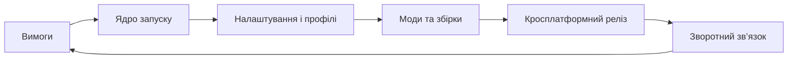
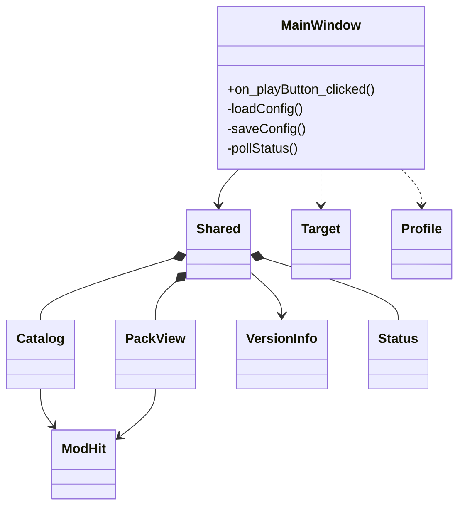
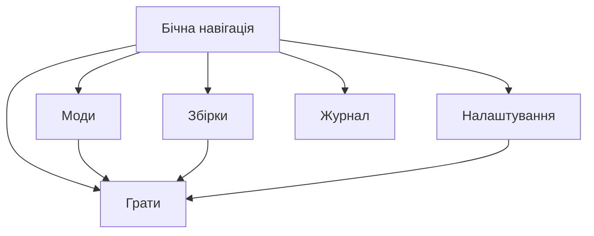
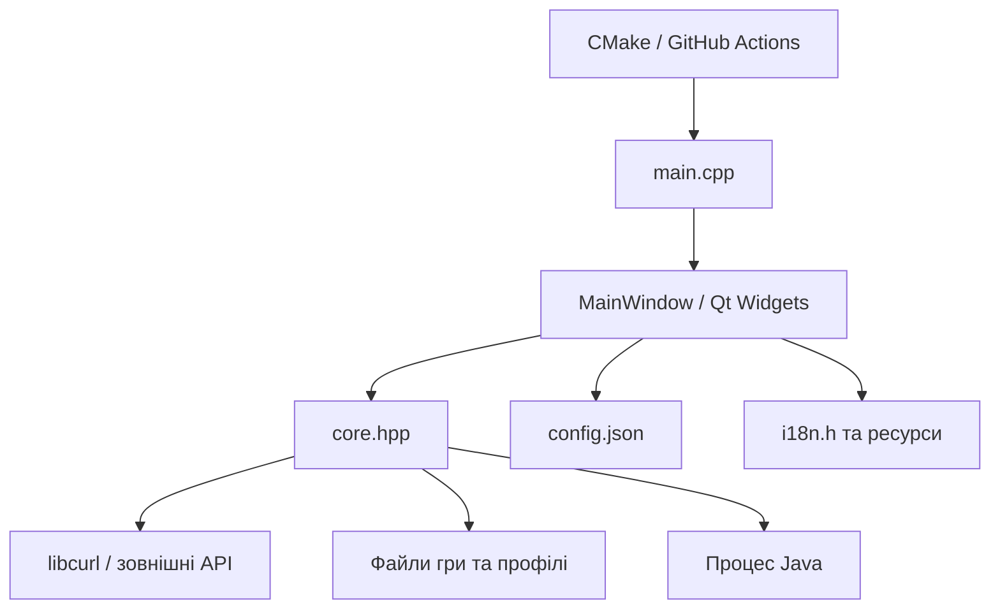

# Практичні роботи №1–20 — CyberLauncher

**Команда:** CyberLeaks  
**Проєкт:** CyberLauncher — лаунчер Minecraft  
**Репозиторій:** https://github.com/DenyRun0/CyberLauncher  
**База аналізу:** main, commit `c623fa1b5cf9f2ce8b6c9cd812ca6cafd63373e2`.

Документ поєднує надані напрацювання та аналіз вихідного коду. Запропоновані тести, задачі й зміни не є підтвердженням їх фактичного виконання. Репозиторій не змінювався.

## Практична №1. Вступ до програмної інженерії та формування команди
**Мета:** сформувати Project Vision.

| Учасник | Роль |
|---|---|
| Ружило Денис | Тімлід, програміст |
| Васюхник Кирило | Графічний інтерфейс |
| Загірський Олексій | Тестувальник |
| Гуменюк Владислав | Системний аналітик |
| Книж Микола | Системний аналітик |

Програмна інженерія — систематичний підхід до створення, тестування та супроводу ПЗ. Етапи: аналіз, вимоги, проєктування, реалізація, тестування, реліз, супровід.

**Project Vision:** створити безкоштовний лаунчер без реклами для гравців Minecraft, який спрощує вибір версій, запуск гри та встановлення модів і збірок. Цільова аудиторія — новачки та досвідчені гравці. Безпека й зручність є цілями, а не гарантіями. Ліцензійні умови Minecraft мають дотримуватися.

**Висновок:** визначено команду, проблему та бачення продукту.

## Практична №2. Аналіз проблеми, користувачів та предметної області
**Мета:** визначити предметну область і межі системи.

Проблема: складність ручного встановлення модів, налаштування Java та керування версіями; реклама в деяких аналогах. Потреби: простий запуск, пошук сумісних модів, збереження параметрів, зрозумілі помилки.

| Об’єкт | Призначення та зв’язки |
|---|---|
| Локальний профіль | Нікнейм і параметри запуску; не є підтвердженням ліцензії |
| Версія Minecraft | Визначає файли гри та потрібну Java |
| Завантажувач | Vanilla або Fabric; визначає сумісність модів |
| Збірка | Містить версію гри, Fabric і набір модів |
| Мод | Належить до каталогу; встановлюється у відповідну папку |
| Java | Середовище виконання гри |

Сценарії: вибір версії → запуск; пошук мода → встановлення → перегляд або видалення; пошук збірки → встановлення → вибір; зміна RAM → збереження. Межі: Windows і macOS, Minecraft 1.19+ за README, Fabric та Modrinth. Сервери Minecraft, власний магазин і Microsoft-авторизація не підтверджені як реалізовані.

**Висновок:** описано об’єкти, потреби й межі системи.

## Практична №3. Життєвий цикл ПЗ
**Мета:** обрати модель SDLC.

| Модель | Особливість | Обмеження |
|---|---|---|
| Waterfall | Послідовні етапи | Складно змінювати вимоги |
| Ітеративно-інкрементна | Поступове додавання функцій | Потрібна інтеграція |
| Спіральна | Аналіз ризиків на кожному циклі | Складніша організація |
| Agile | Гнучке планування і зворотний зв’язок | Потребує координації |

Обрана ітеративно-інкрементна модель: ядро запуску можна перевірити раніше за каталоги модів та оформлення.


Кожна ітерація: планування → проєктування → реалізація → тестування. Microsoft-авторизація залишається можливою окремою ітерацією.

**Висновок:** модель дозволяє поступово розширювати продукт.

## Практична №4. Формування вимог
**Мета:** створити документ вимог.

Користувачі: гравці, новачки, моддери; розробники й тестувальники підтримують продукт.

| ID | User Story / функціональна вимога | Пріоритет | Критерій приймання |
|---|---|---|---|
| US1 | Як гравець, хочу вибрати версію гри | Високий | Вибір відображається на екрані |
| US2 | Як гравець, хочу запустити гру | Високий | За виконаних передумов стартує процес гри |
| US3 | Як гравець, хочу змінити RAM | Високий | Параметр використовується при запуску |
| US4 | Як користувач, хочу зберігати налаштування | Високий | Після перезапуску значення відновлюються |
| US5 | Як гравець, хочу бачити прогрес і помилки | Високий | Статус або повідомлення відображається |
| US6 | Як моддер, хочу знайти та встановити мод | Середній | Сумісний файл з’являється у папці модів |
| US7 | Як гравець, хочу встановити та видалити збірку | Середній | Список профілів оновлюється |
| US8 | Як користувач, хочу змінити мову | Низький | Інтерфейс оновлюється |
| US9 | Як моддер, хочу видалити мод | Середній | Вибраний мод зникає зі списку |

Нефункціональні вимоги: зрозумілий UI, підтримка Windows/macOS, обробка мережевих помилок, перевірка шляхів і джерел завантаження, збереження конфігурації. Цільова вимога до чуйності: інтерфейс не блокується під час мережевих операцій. Повноцінне редагування довільних профілів та Microsoft-авторизація потребують окремої перевірки/реалізації.

**Висновок:** сформовано вимоги та пріоритети.

## Практична №5. User Stories та критерії приймання
**Мета:** деталізувати backlog.

| ID | Передумова | Дія | Очікуваний результат |
|---|---|---|---|
| US1 | Список версій доступний | Вибрати версію | Змінюється вибрана версія |
| US2 | Версія вибрана, є право користування грою | Натиснути «Грати» | Запуск або зрозуміла помилка |
| US3 | Відкриті налаштування | Змінити RAM | Нове допустиме значення збережено |
| US4 | Параметри змінені | Перезапустити лаунчер | Параметри відновлено |
| US5 | Немає мережі або Java | Почати запуск | Статус помилки або автоматичне отримання Java |
| US6 | Вибрано Fabric | Знайти й встановити сумісний мод | Файл і залежності доступні |
| US7 | Є сумісна збірка | Встановити, потім видалити | Профіль додається та видаляється |
| US8 | Відкриті налаштування | Змінити мову | Підписи оновлюються |
| US9 | Мод встановлено | Видалити його | Файл видалено, список оновлено |

Додаткова історія з початкового документа: вимикання JAR-модів без видалення — запланована, реалізацію не підтверджено. Історії містять роль, дію і результат; критерії описують спостережувану поведінку.

**Висновок:** backlog підготовлено до планування й тестування.

## Практична №6. Use Case Diagram
**Мета:** описати взаємодію акторів із системою.

Актори: гравець, сервіси метаданих Minecraft, Modrinth, сервіс Java. Авторизаційний сервер — перспективний актор.


| Use Case | Основний сценарій | Альтернативний сценарій |
|---|---|---|
| Запуск | Вибрати версію, натиснути «Грати», підготувати файли, запустити процес | Помилка мережі/файлів → статус і журнал |
| Встановлення мода | Вибрати Fabric, знайти мод, встановити | Несумісність → повідомлення |
| Налаштування | Відкрити екран, змінити RAM або мову | Некоректне значення не повинно застосовуватись |

**Висновок:** визначено акторів і три основні сценарії.

## Практична №7. Проєктування структури ПЗ
**Мета:** описати класи й компоненти.

Початкова модель команди передбачала Launcher, User, Settings, GameVersion, GameFile, DownloadManager, GameLauncher. У фактичному коді ці обов’язки розподілено між `MainWindow`, структурами та функціями `core`.


`MainWindow` керує UI; `Shared` містить спільний стан; `Catalog` — результати пошуку; `PackView` — склад збірки; `Target` — місце встановлення; `VersionInfo`, `Status`, `ModHit`, `Profile` описують дані ядра. Мережеві операції відокремлені від UI функціями `core.hpp`.

**Висновок:** діаграма відображає реальні типи, а не вигадані класи.

## Практична №8. Проєктування інтерфейсу
**Мета:** описати екрани й навігацію.

| Екран | Елементи |
|---|---|
| Грати | Нікнейм, версія, завантажувач, кнопка запуску |
| Моди | Пошук, категорія, сортування, встановлення та видалення |
| Збірки | Каталог, встановлені збірки, перегляд складу |
| Налаштування | RAM, снапшоти, мова, відкриття папки гри |
| Журнал | Логи та діагностика |


Сценарії: запуск Vanilla; встановлення мода і запуск Fabric; зміна RAM і повернення на головний екран. Екрани підтверджено скриншотами у наданому DOCX та `mainwindow.ui`/`mainwindow.cpp`. Для Figma необхідно створити п’ять фреймів і зв’язати їх кнопками бічного меню. Посилання на Figma не надано; цей опис не замінює інтерактивний прототип.

**Висновок:** описано інтерфейс і переходи.

## Практична №9. Основи Git та GitHub
**Мета:** організувати контроль версій.

Репозиторій створено; наявні `README.md`, `.gitignore`, гілки `main`, `Denys`. `.gitignore` виключає `build/`, `game/`, `config.json`, `*.user`, `.DS_Store`.

```bash
git --version
git clone https://github.com/DenyRun0/CyberLauncher.git
cd CyberLauncher
git log --oneline
git branch -a
git pull origin main
git switch -c docs-lab-example
# після редагування документації:
git add README.md
git commit -m "Update documentation"
git push -u origin docs-lab-example
```
Команди наведено як інструкцію, а не журнал виконання.

| Commit | Опис |
|---|---|
| c623fa1 | Лабароторні |
| 225e3a4 | Auto-download Java |
| a1172c2 | Роблю запуск на віндовс і на мак |
| 390459c | Windows і Mac, автоматична збірка |
| 0bdc30a | Змінив інтерфейс добавив можливість завантажувати моди і модмаки |

**Висновок:** наявність репозиторію та історії підтверджено.

## Практична №10. Командна робота з Git та GitHub
**Мета:** організувати командний workflow.

Фактично наявні `main` та `Denys`. Pull Requests у доступному списку відсутні. Пропоновані гілки: `feature/ui` (Кирило), `test/cases` (Олексій), `docs/requirements` (Владислав); Денис інтегрує зміни.

Порядок: створити гілку від main → змінити відповідний файл → commit → push → Pull Request → review → виправлення → merge. Приклад навчального конфлікту: дві гілки змінюють один рядок README. Після `git merge` залишити узгоджений текст, прибрати маркери конфлікту, виконати `git add README.md` і `git commit`.

Критерії review: відповідність вимогам, відсутність секретів, читабельність, перевірка збірки. Для завершення роботи потрібні реальні PR, review та підтвердження merge; їх не створювали в межах цього звіту.

**Висновок:** розроблено командний процес; частина практичних дій ще потребує виконання.

## Практична №11. Архітектура та структура проєкту
**Мета:** визначити модулі та їх взаємодію.

```text
CyberLauncher/
├── main.cpp
├── mainwindow.cpp / mainwindow.h / mainwindow.ui
├── core.hpp
├── i18n.h
├── resources.qrc
├── icons/ та include/nlohmann/
├── CMakeLists.txt
├── .github/workflows/build.yml
├── run-mac.command / run-windows.bat
├── README.md
└── Laboratory/
```


Технології: C++17, Qt6 Widgets, libcurl, nlohmann/json, CMake 3.20+. `core.hpp` об’єднує мережеві, файлові й ігрові операції; `MainWindow` координує їх через фонові потоки, атомарні змінні та mutex. Поділ UI і ядра спрощує супровід, хоча великий заголовок ядра доцільно згодом розділити.

**Висновок:** описано фактичну архітектуру.

## Практична №12. Планування розробки та MVP
**Мета:** визначити мінімальну робочу версію.

**1. Аналіз backlog**

Backlog — це повний список функціоналу, який планується реалізувати. На основі твого скріншоту можна припустити або доповнити приблизний backlog:
 Потенційні функції:

- Вибір версії гри (поточна: 26.3)
- Вибір завантажувача (Vanilla, без модів)
- Введення нікнейму користувача
- Кнопка "ГРАТИ" для запуску гри
- Відображення статусу (час у грі, остання гра)
- Меню навігації:
  - Грати (основний екран)
  - Моди (управління модами)
  - Збірки (пакети модів чи конфігурацій)
  - Налаштування (загальні опції, Java, графіка, тощо)
  - Журнал (лог подій і помилок)
- Прогрес-бар стану завантаження або запуску
- Збереження і завантаження налаштувань

**2. Визначення MVP**

MVP (Minimum Viable Product) — це мінімально необхідний набір функцій, які потрібно реалізувати, щоб продукт міг працювати та бути корисним.

Обов’язкові функції для MVP:
- Вибір версії гри
- Вибір типу завантажувача (напр., Vanilla)
- Введення нікнейму
- Кнопка запуску гри ("ГРАТИ"), що реально запускає гру
- Відображення базового статусу (поточна версія, час гри)
- Основний UI для навігації (екран “Грати”)

Цей набір дозволить запустити гру і мати базову взаємодію користувача з програмою.


**3. Додаткові функції (поза MVP)**

Функції, які можна реалізувати після основи:

- Управління модами (Завантаження, увімкнення/вимкнення)
- Збірки (управління пакетами конфігурацій і модів)
- Розширені налаштування (Java, графіка, оновлення)
- Журнал подій/помилок
- Прогрес-бар завантаження й інформування користувача
- Статистика і історія ігор (час у грі, остання сесія)

**4. Розбиття User Stories на задачі**

Приклад User Story:  
Як користувач, я хочу обрати версію гри, щоб грати саме в потрібну версію.

Задачі:  
- Розробити інтерфейс вибору версії  
- Зберігати вибрану версію у налаштуваннях  
- Забезпечити передачу вибраної версії до процесу запуску гри  

Інші User Stories можна побудувати й для кожної функції.

**5. Порядок виконання**

1. Створення базового UI з можливістю вводити нікнейм, вибирати версію і тип завантажувача.  
2. Реалізація кнопки “ГРАЙ” з базовим запуском гри.  
3. Відображення основної інформації про версію і час у грі.  
4. Збереження і завантаження вибраних налаштувань.  
5. Наступним етапом — реалізація модулів для модів і збірок (позапланово для MVP).  
6. Далі — меню налаштувань та журналів.  

 **6. План першої ітерації**
**Мета**: Реалізувати базовий запуск гри із мінімальним UI (MVP)

**Задачі**:

- Створити головний екран з полями для нікнейму, вибору версії і завантажувача.  
- Реалізувати кнопку запуску з базовою логікою.  
- Відобразити базову інформацію (версія, час, статус гри).  
- Впровадити просте збереження обраних налаштувань.  
- Провести тестування базової функціональності.


## Практична №13. Початок розробки
**Мета:** перейти від проєктування до практичної реалізації програмного продукту, проаналізувати реалізацію першої User Story, дослідити взаємодію основних компонентів лаунчера та визначити критерії перевірки його функціональності.

US1 реалізована у поточному коді: `core::fetchVersions()` отримує список версій, `MainWindow::loadVersionsAsync()` запускає фонове отримання, `fillVersionBox()` заповнює список, `currentVersionId()` повертає вибір. `pollStatus()` оновлює UI. Передбачено кеш manifest.

Алгоритм роботи US1

1.Користувач запускає CyberLauncher.

2.Програма ініціалізує головне вікно.

3.Запускається фонове отримання списку версій Minecraft.

4.Отримані дані обробляються та передаються до графічного інтерфейсу.

5.Користувач переглядає доступні версії та вибирає потрібну.

6.Вибрана версія використовується для подальшої підготовки запуску гри.

7.Налаштування користувача зберігаються для наступного запуску програми.

Для перевірки US1 передбачено такі дії:

1.Запустити програму та дочекатися завантаження списку версій.

2.Перевірити відображення доступних релізів.

3.Увімкнути та вимкнути показ Snapshot-версій.

4.Вибрати потрібну версію Minecraft.

5.Перевірити повторне оновлення списку версій.

6.Перевірити збереження вибору після перезапуску програми.

7.Перевірити використання кешованого manifest.

Фактичний запуск програми та виконання тестів не проводилися. Реалізацію функціональності підтверджено статичним аналізом вихідного коду. Історія Git підтверджує наявність відповідної функціональності, але не дозволяє однозначно встановити окремий commit першої User Story. Інструкції зі збирання проєкту наведені у README.

**Висновок:** під час виконання практичної роботи було проаналізовано початкову реалізацію CyberLauncher та досліджено першу User Story, пов'язану з отриманням і вибором версій Minecraft. Розглянуто фонове завантаження даних, використання локального кешу, підтримку Snapshot-версій, оновлення списку та збереження налаштувань. Визначено основні етапи роботи функціональності та підготовлено сценарії її перевірки.

## Практична №14. Реалізація функціональності та інтеграція
**Мета:** проаналізувати реалізацію трьох історій.

| Історія | Реалізація | Локальна перевірка (план) |
|---|---|---|
| US2 | `on_playButton_clicked`, `installAndRun`, `ensureJava`, `spawnGame` | Запустити сумісну версію |
| US6 | `searchProjects`, `installMod`, `on_modInstallButton_clicked` | Встановити сумісний мод |
| US7 | `installModpack`, `listProfiles`, `deleteProfile` | Встановити та видалити збірку |

Commit `0bdc30a` описує додавання модів і збірок, `225e3a4` — автоматичне завантаження Java. Інтеграція функцій видима в main. PR та результати локального тестування не підтверджені. Для командної інтеграції застосовується процес №10, після merge потрібно повторити тест-кейси №15.

**Висновок:** функціональний прототип наявний у коді; працездатність потребує запуску.


# Лабораторна робота №15

## Основи тестування програмного забезпечення

**Проєкт:** CyberLauncher — лаунчер для Minecraft.

## Мета роботи

Ознайомитися з основними видами та методами тестування програмного забезпечення, навчитися створювати тест-кейси, визначати позитивні та негативні сценарії, проводити ручне тестування програмного продукту.

## 1. Визначення функціональності для тестування

Для перевірки працездатності CyberLauncher було визначено такі основні функції:

  - Запуск та завантаження лаунчера.
  - Введення та перевірка нікнейму користувача.
  - Вибір версії Minecraft.
  - Вибір типу завантажувача гри.
  - Вибір та завантаження модифікацій.
  - Запуск гри за допомогою кнопки «ГРАТИ».
  - Відображення часу перебування у грі.
  - Відображення інформації про останній запуск гри.
  - Коректність роботи графічного інтерфейсу.
  - Обробка помилок.
  - Обробка відсутності інтернет-з'єднання.
  - Сумісність з операційною системою Windows, враховуючи розробку на macOS.

## 2. Позитивні сценарії тестування

Позитивне тестування передбачає перевірку роботи програми за умови правильних дій користувача та коректних вхідних даних.

  1. Користувач запускає лаунчер, головне вікно відкривається без помилок.
  2. Користувач вводить коректний нікнейм, вибирає версію Minecraft та запускає гру без модифікацій.
  3. Користувач вибирає сумісні модифікації та запускає Minecraft із ними.
  4. Користувач змінює версію гри, після чого лаунчер використовує вибрану версію.
  5. Після завершення гри інформація про час гри та останній запуск оновлюється.
  6. Кнопки та елементи графічного інтерфейсу коректно реагують на дії користувача.
  7. Лаунчер успішно завантажує необхідні файли гри.

## 3. Негативні сценарії тестування

Негативне тестування передбачає перевірку поведінки програмного продукту у випадку неправильних дій користувача або виникнення непередбачених ситуацій.

  1. Користувач залишає поле нікнейму порожнім.
  2. Користувач вводить нікнейм із недопустимими символами.
  3. Користувач намагається запустити недоступну версію Minecraft.
  4. Користувач вибирає несумісні або пошкоджені модифікації.
  5. Під час завантаження модифікацій зникає інтернет-з'єднання.
  6. Під час запуску гри відсутні необхідні файли.
  7. Виникають проблеми із сумісністю лаунчера на Windows.
  8. Користувач декілька разів поспіль натискає кнопку «ГРАТИ».

У таких ситуаціях програма повинна коректно обробляти помилки, повідомляти користувача про проблему та не завершувати роботу аварійно.

## 4. Створення тест-кейсів

| ID | Назва тесту | Дії користувача | Очікуваний результат |
|---|---|---|---|
| TC-01 | Запуск лаунчера | Відкрити CyberLauncher | Головне вікно відкривається без помилок |
| TC-02 | Коректний нікнейм | Ввести Player123 | Нікнейм приймається |
| TC-03 | Запуск Vanilla | Ввести нікнейм, вибрати версію та натиснути «ГРАТИ» | Minecraft успішно запускається |
| TC-04 | Запуск із модами | Вибрати сумісні модифікації та запустити гру | Гра запускається з модами |
| TC-05 | Порожній нікнейм | Залишити поле порожнім та натиснути «ГРАТИ» | Запуск заборонено |
| TC-06 | Некоректний нікнейм | Ввести !@# | Відображається повідомлення про помилку |
| TC-07 | Недоступна версія | Спробувати запустити недоступну версію | Лаунчер повідомляє про помилку |
| TC-08 | Відсутність інтернету | Відключити інтернет та спробувати завантажити мод | Відображається попередження |
| TC-09 | Несумісний мод | Спробувати встановити несумісну модифікацію | Помилка коректно обробляється |
| TC-10 | Робота на Windows | Запустити лаунчер на Windows | Програма працює стабільно |
| TC-11 | Оновлення статистики | Запустити та завершити гру | Інформація про час гри оновлюється |
| TC-12 | Повторний запуск | Декілька разів натиснути «ГРАТИ» | Не відбувається дублювання запуску |

## 5. Проведення ручного тестування

Ручне тестування проводиться шляхом послідовного виконання створених тест-кейсів.

Під час перевірки необхідно порівнювати фактичний результат роботи програми з очікуваним.

Для фіксації результатів використовуються такі статуси:

- **Passed** — тест пройдено успішно.
- **Failed** — виявлено помилку.
- **Not tested** — тест ще не виконано.
- **Blocked** — виконання тесту заблоковано іншою проблемою.

## 6. Результати тестування

| ID | Функціональність | Статус |
|---|---|---|
| TC-01 | Запуск лаунчера | Not tested |
| TC-02 | Введення нікнейму | Not tested |
| TC-03 | Запуск Minecraft | Not tested |
| TC-04 | Запуск із модами | Not tested |
| TC-05 | Порожній нікнейм | Not tested |
| TC-06 | Некоректний нікнейм | Not tested |
| TC-07 | Недоступна версія | Not tested |
| TC-08 | Відсутність інтернету | Not tested |
| TC-09 | Несумісність модів | Not tested |
| TC-10 | Сумісність із Windows | Not tested |
| TC-11 | Оновлення статистики | Not tested |
| TC-12 | Повторний запуск | Not tested |

## 7. Аналіз та подальші дії

Після проведення ручного тестування необхідно:

  - Зафіксувати виявлені помилки.
  - Визначити причини виникнення помилок.
  - Створити Issues у GitHub.
  - Передати інформацію учасникам команди.
  - Виправити виявлені недоліки.
  - Провести повторне тестування.
  - За необхідності розширити набір тест-кейсів.

## Висновок

У ході лабораторної роботи було розглянуто основні принципи тестування програмного забезпечення, визначено функціональність CyberLauncher, яка потребує перевірки, сформовано позитивні та негативні сценарії, розроблено 12 тест-кейсів.

Підготовлені тест-кейси дозволяють перевірити стабільність роботи лаунчера, виявити можливі помилки та підвищити якість програмного продукту. Результати фактичного тестування будуть внесені після виконання перевірок.

# Лабораторна робота №16

## Автоматизоване тестування програмного забезпечення

## Мета роботи

Ознайомитися з принципами автоматизованого тестування програмного забезпечення, навчитися створювати автоматизовані тести, перевіряти правильність роботи окремих функцій програми, аналізувати результати тестування та виправляти виявлені помилки.

## 1. Поняття автоматизованого тестування

Автоматизоване тестування — це процес перевірки працездатності програмного забезпечення за допомогою спеціально створених програмних тестів, які виконуються без постійного втручання користувача.

Основні переваги автоматизованого тестування:

  - Зменшення часу на перевірку програмного забезпечення.
  - Можливість багаторазового виконання тестів.
  - Швидке виявлення помилок у програмному коді.
  - Зменшення впливу людського фактора.
  - Перевірка працездатності після внесення змін.
  - Підвищення стабільності програмного продукту.
  - Спрощення командної розробки.
  - Можливість інтеграції тестування з GitHub Actions.

## 2. Визначення функцій для автоматизованого тестування

Для програмного продукту CyberLauncher було обрано такі функції:

  1. Перевірка правильності введення нікнейму.
  2. Перевірка порожнього поля нікнейму.
  3. Перевірка недопустимих символів.
  4. Перевірка формату файлів модифікацій.
  5. Перевірка доступності вибраної версії Minecraft.

Для реалізації автоматизованих тестів обрано мову програмування C++ та бібліотеку Qt Test.

## 3. Створення автоматизованих тестів

### Тест №1. Перевірка коректного нікнейму

  - Мета: перевірити правильність обробки допустимого нікнейму.
  - Вхідні дані: Player123.
  - Очікуваний результат: нікнейм приймається.
  - Тип тесту: позитивний.

### Тест №2. Перевірка порожнього нікнейму

  - Мета: перевірити поведінку програми за відсутності нікнейму.
  - Вхідні дані: порожній рядок.
  - Очікуваний результат: нікнейм відхиляється.
  - Тип тесту: негативний.

### Тест №3. Перевірка недопустимих символів
 
  - Мета: перевірити обробку некоректних символів.
  - Вхідні дані: Player!@#.
  - Очікуваний результат: нікнейм не проходить перевірку.
  - Тип тесту: негативний.

### Тест №4. Перевірка формату модифікацій

  - Мета: перевірити розширення файлів модифікацій.
  - Вхідні дані: sodium.jar, mod.txt.
  - Очікуваний результат: формат .jar приймається, формат .txt відхиляється.
  - Тип тесту: позитивний та негативний.

### Тест №5. Перевірка версії Minecraft

  - Мета: перевірити наявність вибраної версії гри у списку.
  - Вхідні дані: 1.21.1, 99.99.99.
  - Очікуваний результат: доступна версія приймається, неіснуюча версія відхиляється.
  - Тип тесту: позитивний та негативний.

## 4. Програмна реалізація

Приклад автоматизованих тестів мовою C++ з використанням Qt Test:

```cpp
#include <QtTest>
#include <QString>
#include <QStringList>
#include <QRegularExpression>

bool isValidNickname(const QString &nickname)
{
    static const QRegularExpression regex(
        "^[A-Za-z0-9_]{3,16}$"
    );

    return regex.match(nickname).hasMatch();
}

bool isValidMod(const QString &filename)
{
    return filename.endsWith(
        ".jar", Qt::CaseInsensitive
    );
}

bool isValidVersion(const QString &version)
{
    const QStringList versions = {
        "1.21.1"
    };

    return versions.contains(version);
}

class CyberLauncherTests : public QObject
{
    Q_OBJECT

private slots:

    void testValidNickname()
    {
        QVERIFY(isValidNickname("Player123"));
    }

    void testEmptyNickname()
    {
        QVERIFY(!isValidNickname(""));
    }

    void testInvalidNickname()
    {
        QVERIFY(!isValidNickname("Player!@#"));
    }

    void testModFormat()
    {
        QVERIFY(isValidMod("sodium.jar"));
        QVERIFY(!isValidMod("mod.txt"));
    }

    void testGameVersion()
    {
        QVERIFY(isValidVersion("1.21.1"));
        QVERIFY(!isValidVersion("99.99.99"));
    }
};

QTEST_APPLESS_MAIN(CyberLauncherTests)

#include "test_cyberlauncher.moc"
```

## 5. Опис програмного коду

| Функція | Призначення |
|---|---|
| isValidNickname() | Перевірка правильності нікнейму |
| isValidMod() | Перевірка розширення файлу модифікації |
| isValidVersion() | Перевірка наявності версії гри у списку |
| QVERIFY() | Перевірка виконання заданої умови |
| QTEST_APPLESS_MAIN() | Створення точки входу для запуску тестів |

Кожен автоматизований тест перевіряє відповідність отриманого результату очікуваному.

Якщо умова виконується, тест вважається успішним. Якщо умова не виконується, система тестування повідомляє про помилку.

Наведений код є прикладом тестування допоміжних функцій. Для повноцінної перевірки CyberLauncher необхідно підключити реальні функції програмного продукту.

## 6. Запуск автоматизованих тестів

Для запуску автоматизованого тестування необхідно:

  1. Створити папку tests у репозиторії CyberLauncher.
  2. Створити файл test_cyberlauncher.cpp.
  3. Додати програмний код автоматизованих тестів.
  4. Підключити бібліотеку Qt Test.
  5. Налаштувати окрему ціль збирання тестів.
  6. Виконати збирання тестового застосунку.
  7. Запустити автоматизовані тести.
  8. Проаналізувати отримані результати.

Рекомендована структура репозиторію:

```text
CyberLauncher/
├── .github/
├── Laboratory/
│   ├── Laboratory15.md
│   └── Laboratory16.md
├── game/
├── tests/
│   └── test_cyberlauncher.cpp
├── core.hpp
├── main.cpp
├── mainwindow.cpp
└── README.md
```

## 7. Очікувані результати тестування

| ID | Назва тесту | Очікуваний статус | Фактичний статус |
|---|---|---|---|
| AT-01 | Коректний нікнейм | Passed | Not tested |
| AT-02 | Порожній нікнейм | Passed | Not tested |
| AT-03 | Некоректний нікнейм | Passed | Not tested |
| AT-04 | Формат модифікації | Passed | Not tested |
| AT-05 | Версія Minecraft | Passed | Not tested |

### Цільові показники

  - Загальна кількість тестів: 5.
  - Очікувана кількість успішних тестів: 5.
  - Очікувана кількість провалених тестів: 0.
  - Цільовий відсоток успішності: 100%.

Фактичні результати необхідно отримати після запуску автоматизованих тестів.

## 8. Аналіз результатів та виправлення помилок

Після виконання автоматизованих тестів необхідно проаналізувати отримані результати.

У разі виявлення помилок необхідно:

  - Визначити тест, який не пройшов перевірку.
  - Проаналізувати причину виникнення помилки.
  - Внести відповідні зміни до програмного коду.
  - Повторно запустити автоматизовані тести.
  - Зафіксувати результати.
  - Виконати commit та push до GitHub.

## 9. Подальше вдосконалення тестування

У майбутньому систему автоматизованого тестування CyberLauncher можна розширити такими перевірками:

  - Завантаження модифікацій.
  - Перевірка сумісності модифікацій.
  - Збереження налаштувань користувача.
  - Завантаження файлів Minecraft.
  - Робота графічного інтерфейсу.
  - Обробка мережевих помилок.
  - Оновлення статистики користувача.
  - Сумісність із різними операційними системами.
  - Автоматичний запуск тестів через GitHub Actions.

## Висновок

У ході лабораторної роботи було розглянуто принципи автоматизованого тестування програмного забезпечення, визначено основні функції CyberLauncher для автоматизованої перевірки та підготовлено п'ять автоматизованих тестів мовою C++ з використанням бібліотеки Qt Test.

Використання автоматизованого тестування дозволяє скоротити час перевірки програмного продукту, своєчасно виявляти помилки, спрощувати командну розробку та підвищувати надійність CyberLauncher.

Наступним етапом є інтеграція тестів із реальними функціями лаунчера, їх запуск та фіксація фактичних результатів.


## Практична №17. Управління програмним проєктом
**Мета:** сформувати backlog, Kanban і sprint.

| Задача | Пріоритет | Виконавець (план) | Статус за доступними даними |
|---|---|---|---|
| US1–2 Версії та запуск | Високий | Денис | Код наявний |
| US3–5 Налаштування та журнал | Високий | Денис, Кирило | Код наявний |
| US6–9 Моди, збірки, мова | Середній | Денис, Кирило | Код наявний |
| TC01–10 Ручні тести | Високий | Олексій | Backlog |
| Автоматизовані тести | Високий | Олексій, Денис | Backlog |
| Документація і Figma | Середній | Владислав, Кирило | Backlog |

Kanban: Backlog → To Do → In Progress → Review → Done. Наявність коду не означає Done без приймання. Запропонований sprint — 7 днів: дні 1–2 уточнення вимог і тестів, 3–4 перевірка запуску й модів, 5 виправлення, 6 повторне тестування, 7 демонстрація. Дошку можна перенести в GitHub Projects; її створення та фактичний рух карток не підтверджені.

**Висновок:** підготовлено план управління.

## Практична №18. Пошук, аналіз та виправлення помилок
**Мета:** сформувати три задачі на основі статичного аналізу.

| Кандидат Issue | Умови / проблема | Пріоритет | Запропоноване виправлення та перевірка |
|---|---|---|---|
| BUG-01 | README вимагає встановлену Java, хоча `ensureJava` передбачає автозавантаження | Середній | Уточнити README; перевірити запуск без Java |
| BUG-02 | README пропонує `run-mac.command`, але workflow пакує лише `.app` | Високий | Узгодити інструкцію з архівом; перевірити склад релізу |
| BUG-03 | CMake не містить цілі автоматизованих тестів | Середній | Додати CTest із №16; перевірити успішний запуск |

Це підтверджені розбіжності документації/конфігурації, а не три відтворені runtime-дефекти. Для кожної задачі створити Issue з описом, очікуванням, фактом і критерієм закриття; після виправлення провести повторну перевірку та закрити Issue. Список Issues репозиторію порожній; виправлення і закриття не виконані.

**Висновок:** визначено три конкретні проблеми та план усунення.

## Практична №19. Зміна вимог та супровід ПЗ
**Мета:** спланувати зміну продукту.

Нова запропонована вимога US10: як гравець, хочу вимикати та повторно вмикати встановлений мод без повторного завантаження. Пріоритет середній. Вплив: `mainwindow.ui` — кнопка; `mainwindow.h/.cpp` — обробник і список; файлові операції ядра — безпечне перейменування `.jar` ↔ `.jar.disabled` у межах папки модів. Не дозволяти перезапис існуючого файла; не змінювати моди під час гри.

Критерії: вимкнений мод не завантажується Fabric, повторне ввімкнення відновлює файл, колізія імен дає повідомлення, стан видно після перезапуску. Додати задачу до backlog, реалізувати в окремій гілці, перевірити ці чотири сценарії та повторити TC02, TC04–06. Оновити User Manual. Реалізацію нової вимоги не внесено до репозиторію.

**Висновок:** проаналізовано вплив зміни та підготовлено план супроводу.

## Практична №20. Документування та презентація продукту
**Мета:** підготувати документацію і демонстрацію.

### User Manual
CyberLauncher — настільний лаунчер Minecraft з підтримкою Vanilla, Fabric і каталогу Modrinth. Сторінка релізів: https://github.com/DenyRun0/CyberLauncher/releases . Для Windows розпакувати відповідний архів і відкрити `CyberLauncher.exe`. Для macOS — розпакувати архів і відкрити `.app`, якщо він сумісний із системою та перевірено його походження. Не обходити системні попередження безпеки. Наявність конкретного релізу не перевірялась.

Збірка з коду: потрібні CMake 3.20+, Qt6 Widgets, libcurl, C++17. На macOS після встановлення залежностей:

```bash
cmake -B build -DCMAKE_PREFIX_PATH="$(brew --prefix qt)"
cmake --build build
open build/CyberLauncher.app
```

На Windows (Visual Studio, Qt6 і vcpkg):

```powershell
vcpkg install curl:x64-windows
cmake -B build -DCMAKE_TOOLCHAIN_FILE="<vcpkg>/scripts/buildsystems/vcpkg.cmake" -DCMAKE_PREFIX_PATH="<Qt>"
cmake --build build --config Release
```

Замінити `<vcpkg>` і `<Qt>` фактичними шляхами. Запустити `build/Release/CyberLauncher.exe`.

Користування: вибрати версію та завантажувач, налаштувати RAM, натиснути «Грати» за наявності права користування грою. Для модів перейти до «Моди», знайти сумісний проєкт і встановити. Для збірок — «Збірки», пошук, встановлення та вибір профілю. При проблемах переглянути «Журнал». Java підбирається ядром; автоматичне завантаження передбачене кодом. Дані Windows — `game` поруч з exe; macOS — `~/Library/Application Support/CyberLauncher/game` за README.

### План презентації та демонстрації
  1. Назва, команда і проблема.
  2. Цільова аудиторія та вимоги.
  3. Архітектура C++/Qt і зовнішні API.
  4. Демонстрація екранів «Грати», «Моди», «Збірки», «Налаштування», «Журнал».
  5. Приклад пошуку мода, зміни RAM і перегляду статусу запуску.
  6. GitHub, автоматична збірка, тест-кейси, обмеження та наступні кроки.

README наявний, структура репозиторію перевірена. Workflow збирає Windows і macOS та публікує архіви для тегів `v*`; успішність запусків CI не перевірено. Окрема презентація та жива демонстрація ще потрібні.

**Висновок:** підготовлено документацію і сценарій захисту.

## Джерела
- Надані документи «силабус 2026(1).docx» і «Практична ПРоект.docx» (практичні 1–10, скриншоти інтерфейсу).
- [Вихідний код за перевіреним commit](https://github.com/DenyRun0/CyberLauncher/tree/c623fa1b5cf9f2ce8b6c9cd812ca6cafd63373e2).
- [Ядро](https://github.com/DenyRun0/CyberLauncher/blob/main/core.hpp), [UI](https://github.com/DenyRun0/CyberLauncher/blob/main/mainwindow.cpp), [CMake](https://github.com/DenyRun0/CyberLauncher/blob/main/CMakeLists.txt), [CI](https://github.com/DenyRun0/CyberLauncher/blob/main/.github/workflows/build.yml).
- [Історія](https://github.com/DenyRun0/CyberLauncher/commits/main/), [гілки](https://github.com/DenyRun0/CyberLauncher/branches), [Issues](https://github.com/DenyRun0/CyberLauncher/issues), [Pull Requests](https://github.com/DenyRun0/CyberLauncher/pulls).
