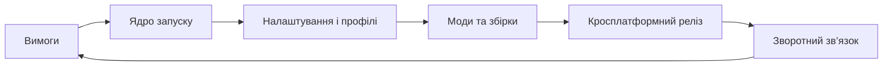
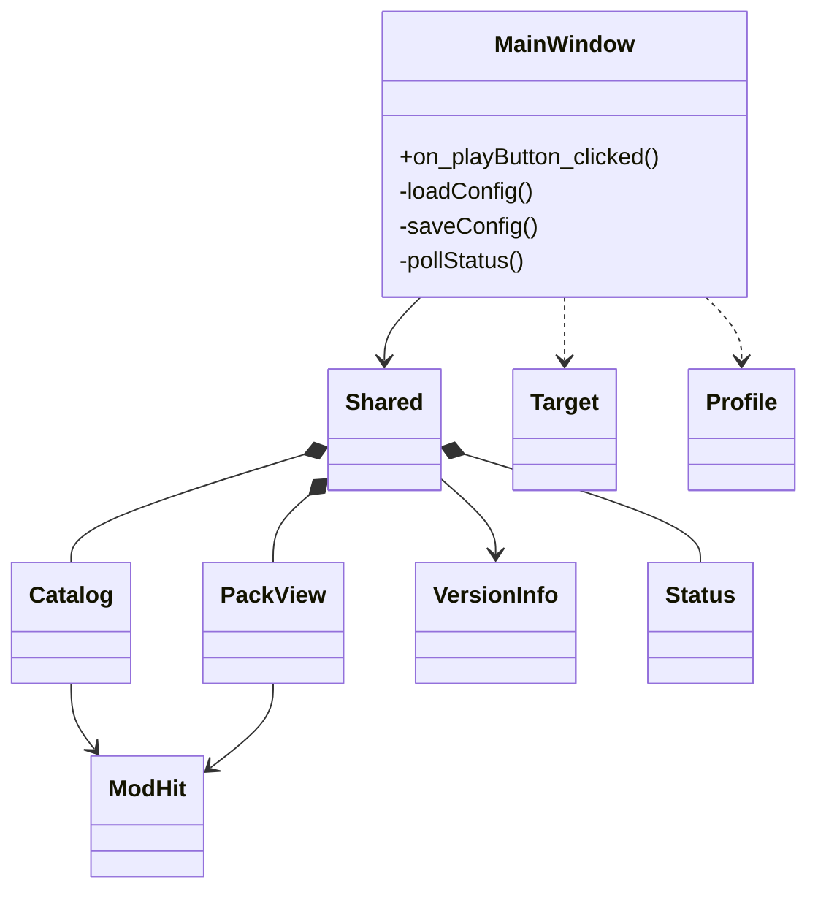
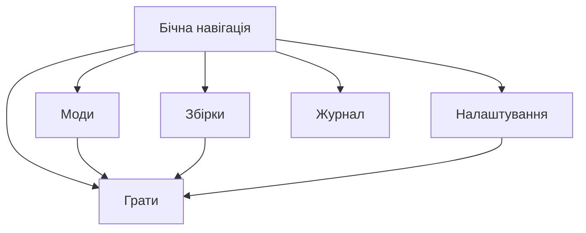
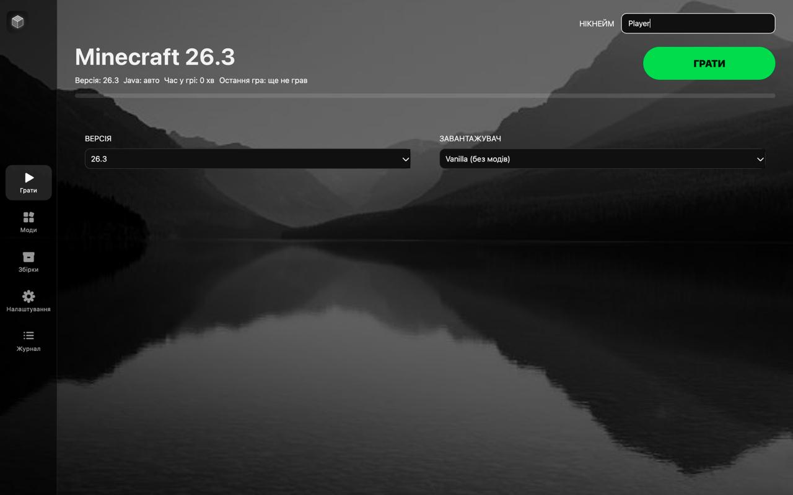
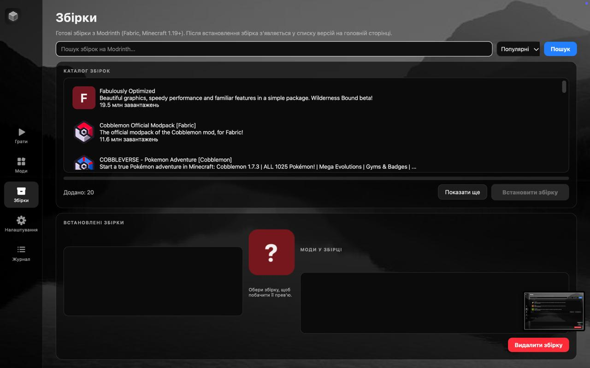
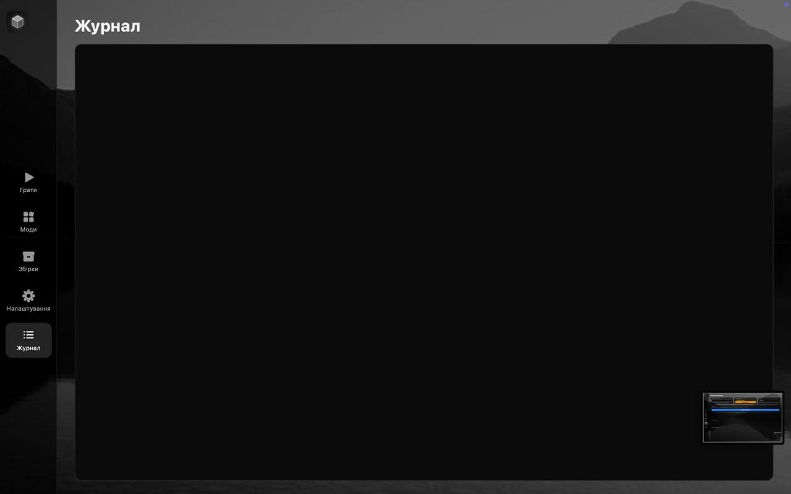
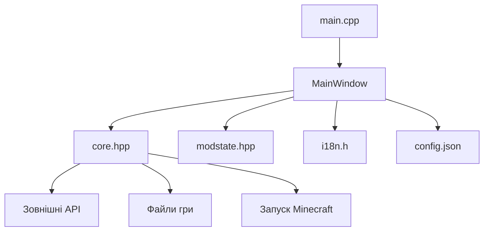

# Практичні роботи №1–20 — CyberLauncher

**Команда:** CyberLeaks  
**Проєкт:** CyberLauncher — лаунчер Minecraft  
**Репозиторій:** https://github.com/DenyRun0/CyberLauncher  


## Практична №1. Вступ до програмної інженерії та формування команди
**Мета:** сформувати Project Vision.

| Учасник | Роль |
|---|---|
| Ружило Денис | Тімлід, програміст |
| Васюхник Кирило | Графічний інтерфейс |
| Загірський Олексій | Тестувальник |
| Гуменюк Владислав | Системний аналітик |
| Книш Микола | Тестувальник |

Програмна інженерія — систематичний підхід до створення, тестування та супроводу ПЗ. Етапи: аналіз, вимоги, проєктування, реалізація, тестування, реліз, супровід.

**Project Vision:** створити безкоштовний лаунчер без реклами для гравців Minecraft, який спрощує вибір версій, запуск гри та встановлення модів і збірок. Цільова аудиторія — новачки та досвідчені гравці. Безпека й зручність є цілями, а не гарантіями. Ліцензійні умови Minecraft мають дотримуватися.

**Висновок:** визначено команду, проблему та бачення продукту.

## Практична №2. Аналіз проблеми, користувачів та предметної області
**Мета:** визначити предметну область і межі системи.

Проблема: складність ручного встановлення модів, налаштування Java та керування версіями; реклама в деяких аналогах. Потреби: простий запуск, пошук сумісних модів, збереження параметрів, зрозумілі помилки.

| Об’єкт | Призначення та зв’язки |
|---|---|
| Локальний профіль | Нікнейм і параметри запуску |
| Версія Minecraft | Визначає файли гри та потрібну Java |
| Завантажувач | Vanilla або Fabric; визначає сумісність модів |
| Збірка | Містить версію гри, Fabric і набір модів |
| Мод | Належить до каталогу; встановлюється у відповідну папку |
| Java | Середовище виконання гри |

Сценарії: вибір версії → запуск; пошук мода → встановлення → перегляд або видалення; пошук збірки → встановлення → вибір; зміна RAM → збереження. Межі: Windows і macOS, Minecraft 1.19+ за README, Fabric та Modrinth. Сервери Minecraft, власний магазин і Microsoft-авторизація не підтверджені як реалізовані.

**Висновок:** описано об’єкти, потреби й межі системи.

## Практична №3. Життєвий цикл ПЗ
**Мета:** обрати модель SDLC.

| Модель | Особливість | Обмеження |
|---|---|---|
| Waterfall | Послідовні етапи | Складно змінювати вимоги |
| інкрементна | Поступове додавання функцій | Потрібна інтеграція |
| Спіральна | Аналіз ризиків на кожному циклі | Складніша організація |
| Agile | Гнучке планування і зворотний зв’язок | Потребує координації |

Обрана ітеративно-інкрементна модель: ядро запуску можна перевірити раніше за каталоги модів та оформлення.


Кожна ітерація: планування → проєктування → реалізація → тестування. Microsoft-авторизація залишається можливою окремою ітерацією.

**Висновок:** модель дозволяє поступово розширювати продукт.

## Практична №4. Формування вимог
**Мета:** створити документ вимог.

Користувачі: гравці, новачки, моддери; розробники й тестувальники підтримують продукт.

| ID | User Story / функціональна вимога | Пріоритет | Критерій приймання |
|---|---|---|---|
| US1 | Як гравець, хочу вибрати версію гри | Високий | Вибір відображається на екрані |
| US2 | Як гравець, хочу запустити гру | Високий | За виконаних передумов стартує процес гри |
| US3 | Як гравець, хочу змінити RAM | Високий | Параметр використовується при запуску |
| US4 | Як користувач, хочу зберігати налаштування | Високий | Після перезапуску значення відновлюються |
| US5 | Як гравець, хочу бачити прогрес і помилки | Високий | Статус або повідомлення відображається |
| US6 | Як моддер, хочу знайти та встановити мод | Середній | Сумісний файл з’являється у папці модів |
| US7 | Як гравець, хочу встановити та видалити збірку | Середній | Список профілів оновлюється |
| US8 | Як користувач, хочу змінити мову | Низький | Інтерфейс оновлюється |
| US9 | Як моддер, хочу видалити мод | Середній | Вибраний мод зникає зі списку |

Нефункціональні вимоги: зрозумілий UI, підтримка Windows/macOS, обробка мережевих помилок, перевірка шляхів і джерел завантаження, збереження конфігурації. Цільова вимога до чуйності: інтерфейс не блокується під час мережевих операцій. Повноцінне редагування довільних профілів та Microsoft-авторизація потребують окремої перевірки/реалізації.

**Висновок:** сформовано вимоги та пріоритети.

## Практична №5. User Stories та критерії приймання
**Мета:** деталізувати backlog.

| ID | Передумова | Дія | Очікуваний результат |
|---|---|---|---|
| US1 | Список версій доступний | Вибрати версію | Змінюється вибрана версія |
| US2 | Версія вибрана, є право користування грою | Натиснути «Грати» | Запуск або зрозуміла помилка |
| US3 | Відкриті налаштування | Змінити RAM | Нове допустиме значення збережено |
| US4 | Параметри змінені | Перезапустити лаунчер | Параметри відновлено |
| US5 | Немає мережі або Java | Почати запуск | Статус помилки або автоматичне отримання Java |
| US6 | Вибрано Fabric | Знайти й встановити сумісний мод | Файл і залежності доступні |
| US7 | Є сумісна збірка | Встановити, потім видалити | Профіль додається та видаляється |
| US8 | Відкриті налаштування | Змінити мову | Підписи оновлюються |
| US9 | Мод встановлено | Видалити його | Файл видалено, список оновлено |

**Висновок:** backlog підготовлено до планування й тестування.

## Практична №6. Use Case Diagram
**Мета:** описати взаємодію акторів із системою.

Актори: гравець, сервіси метаданих Minecraft, Modrinth, сервіс Java. Авторизаційний сервер — перспективний актор.


| Use Case | Основний сценарій | Альтернативний сценарій |
|---|---|---|
| Запуск | Вибрати версію, натиснути «Грати», підготувати файли, запустити процес | Помилка мережі/файлів → статус і журнал |
| Встановлення мода | Вибрати Fabric, знайти мод, встановити | Несумісність → повідомлення |
| Налаштування | Відкрити екран, змінити RAM або мову | Некоректне значення не повинно застосовуватись |

**Висновок:** визначено акторів і три основні сценарії.

## Практична №7. Проєктування структури ПЗ
**Мета:** описати класи й компоненти.

Початкова модель команди передбачала Launcher, User, Settings, GameVersion, GameFile, DownloadManager, GameLauncher. У фактичному коді ці обов’язки розподілено між `MainWindow`, структурами та функціями `core`.


`MainWindow` керує UI; `Shared` містить спільний стан; `Catalog` — результати пошуку; `PackView` — склад збірки; `Target` — місце встановлення; `VersionInfo`, `Status`, `ModHit`, `Profile` описують дані ядра. Мережеві операції відокремлені від UI функціями `core.hpp`.

**Висновок:** діаграма відображає реальні типи, а не вигадані класи.

## Практична №8. Проєктування інтерфейсу
**Мета:** описати екрани й навігацію.

| Екран | Елементи |
|---|---|
| Грати | Нікнейм, версія, завантажувач, кнопка запуску |
| Моди | Пошук, категорія, сортування, встановлення та видалення |
| Збірки | Каталог, встановлені збірки, перегляд складу |
| Налаштування | RAM, снапшоти, мова, відкриття папки гри |
| Журнал | Логи та діагностика |


Сценарії: запуск Vanilla; встановлення мода і запуск Fabric; зміна RAM. Інтерфейс реалізовано у Qt Widgets (`mainwindow.ui`, `mainwindow.cpp`), переходи описано схемою вище. 
**Грати**



**Моди**


**Збірки**



**Налаштування**


**Журнал**



**Висновок:** описано інтерфейс і переходи.

## Практична №9. Основи Git та GitHub
**Мета:** організувати контроль версій.

Репозиторій створено; наявні `README.md`, `.gitignore`, гілки `main`, `Denys`. `.gitignore` виключає `build/`, `game/`, `config.json`, `*.user`, `.DS_Store`.

```bash
git --version
git clone https://github.com/DenyRun0/CyberLauncher.git
cd CyberLauncher
git log --oneline
git branch -a
git pull origin main
git switch -c docs-lab-example
# після редагування документації:
git add README.md
git commit -m "Update documentation"
git push -u origin docs-lab-example
```

```text
git version 2.47.3
Cloning into 'work'...
done.
Already up to date.
Switched to a new branch 'demo/negative-tests'
[demo/negative-tests bb56f52] Додано негативні перевірки модуля
 * [new branch]      demo/negative-tests -> demo/negative-tests
branch 'demo/negative-tests' set up to track 'origin/demo/negative-tests'.
bb56f52 Додано негативні перевірки модуля
bb93514 Початковий знімок модуля
```
Команди clone, pull, switch, add, commit, push, log, status і branch виконано успішно;

| Commit | Опис |
|---|---|
| c623fa1 | Лабароторні |
| 225e3a4 | Auto-download Java |
| a1172c2 | Роблю запуск на віндовс і на мак |
| 390459c | Windows і Mac, автоматична збірка |
| 0bdc30a | Змінив інтерфейс добавив можливість завантажувати моди і модмаки |

**Висновок:** наявність репозиторію та історії підтверджено.

## Практична №10. Командна робота з Git та GitHub
Гілки: main, Denys, labs/tests-and-docs, VladislavGumenuk1-patch-1. [PR #4](https://github.com/DenyRun0/CyberLauncher/pull/4) та [PR #5](https://github.com/DenyRun0/CyberLauncher/pull/5) об'єднані з main. 

### Демонстрація merge conflict
Для перевірки конфлікту створено дві гілки `demo/interface` та `demo/mods`. В обох гілках змінено один і той самий рядок у файлі `README.md`. При об'єднанні гілок виник конфлікт.

```text
<<<<<<< HEAD
Опис: Лаунчер Minecraft із простим інтерфейсом
=======
Опис: Лаунчер Minecraft з каталогом модів
>>>>>>> demo/mods
```

Для вирішення конфлікту потрібно об'єднати обидва описи в один та зберегти зміни.
**Висновок:** GitHub-репозиторій із налаштованим командним workflow.

## Практична №11. Архітектура та структура проєкту
**Мета:** визначити структуру проєкту та взаємодію його компонентів.

**1. Структура проєкту**

Основні файли та папки:

```text
CyberLauncher/
├── main.cpp
├── mainwindow.cpp
├── mainwindow.h
├── mainwindow.ui
├── core.hpp
├── modstate.hpp
├── i18n.h
├── resources.qrc
├── icons/
├── include/
├── tests/
├── CMakeLists.txt
├── .github/workflows/
└── README.md
```

**2. Призначення компонентів**

- `main.cpp` — запуск програми.
- `mainwindow.cpp`, `mainwindow.h`, `mainwindow.ui` — робота та вигляд інтерфейсу.
- `core.hpp` — завантаження файлів, встановлення модів і збірок, запуск гри.
- `modstate.hpp` — увімкнення та вимкнення модів.
- `i18n.h` — переклад інтерфейсу.
- `resources.qrc` та `icons/` — зображення та іконки.
- `include/` — підключені бібліотеки.
- `tests/` — тести програми.
- `CMakeLists.txt` та `.github/workflows/` — налаштування збірки та її автоматизація.
- `README.md` — опис проєкту.

**3. Архітектурна схема**



Коли користувач натискає кнопку «Грати», інтерфейс передає вибрані параметри до основної частини програми. Вона завантажує потрібні файли, перевіряє наявність Java та запускає гру. Налаштування зберігаються у файлі `config.json`.

**4. Обґрунтування**

Для розробки обрали C++ та Qt 6, щоб програма могла працювати на Windows і macOS. Інтерфейс та основну логіку розділили, щоб було простіше додавати нові функції та виправляти помилки.

**Висновок:** визначили структуру проєкту, розподілили функції між компонентами та побудували схему їх взаємодії.

## Практична №12. Планування розробки та створення MVP

**Мета:** визначити, які функції потрібні для першої робочої версії лаунчера.

**1. Backlog та MVP**

Переглянули список завдань і розділили їх на основні та додаткові.

| Основні функції (MVP) | Додаткові функції |
|---|---|
| Введення нікнейму | Встановлення модів |
| Вибір версії Minecraft | Встановлення збірок |
| Вибір Vanilla | Підтримка Fabric |
| Запуск гри та показ статусу | Зміна мови |
| Збереження налаштувань | Журнал та розширена статистика |

MVP нашого проєкту — лаунчер, у якому можна вибрати версію Minecraft та запустити гру.

**2. Розподіл User Stories на задачі**

| User Story | Задачі |
|---|---|
| US1 — вибір версії | Отримати список версій, показати його в програмі, зберегти вибір |
| US2 — запуск гри | Зробити кнопку «Грати», підготувати файли та запустити гру |
| US4 — збереження налаштувань | Записувати налаштування у файл та читати їх при запуску |

**3. План першої ітерації**

1. Створити головне вікно.
2. Додати поле нікнейму та список версій.
3. Реалізувати запуск Vanilla і показ статусу.
4. Додати збереження налаштувань.
5. Перевірити роботу програми та виправити помилки.

Після першої ітерації плануємо додати Fabric, моди, збірки та інші функції.

**Висновок:** визначили MVP та склали план його реалізації.

## Практична №13. Початок розробки програмного продукту

**Мета:** почати розробку першої робочої версії лаунчера.

**1. Структура та основна логіка**

Створено головне вікно програми у Qt. Файли `mainwindow.cpp` та `mainwindow.ui` відповідають за інтерфейс, а `core.hpp` — за отримання версій, підготовку файлів та запуск гри.

**2. Реалізація першої User Story**

US1 — користувач хоче вибрати версію Minecraft.

- При відкритті лаунчер отримує список версій Minecraft.
- Список відображається у головному вікні.
- Користувач вибирає потрібну версію.
- Вибрана версія зберігається в налаштуваннях і використовується при запуску гри.

**3. Перевірка та виправлення помилок**

Під час подальшого тестування перевірили відкриття лаунчера, вибір версії та запуск Vanilla. За результатами практичної №15 ці перевірки пройдено.

Якщо інтернет недоступний, лаунчер може використати раніше збережений список версій.

**4. Commit та README**

Реалізація вибору версій уже є в [коміті 0bdc30a](https://github.com/DenyRun0/CyberLauncher/commit/0bdc30afac3f881f13615bf9475c0e11e4c85655).

У [README.md](README.md) є опис лаунчера та інструкції зі збірки і запуску програми.

**Висновок:** реалізовано основну логіку лаунчера та вибір версії Minecraft.

## Практична №14. Реалізація функціональності та інтеграція

**Мета:** реалізувати основні функції лаунчера та об'єднати зміни.

**1. Реалізація User Stories**

| User Story | Що зробили |
|---|---|
| US2 — запуск гри | Додали підготовку файлів, пошук Java та запуск Minecraft |
| US6 — встановлення модів | Додали пошук і завантаження модів із Modrinth |
| US7 — керування збірками | Додали встановлення та видалення збірок |

**2. Перевірка роботи**

Перевірили запуск Vanilla і Fabric, пошук та встановлення модів, встановлення збірок. Результати записали у практичній №15.

**3. Робота з GitHub**

Зміни зберегли в комітах [0bdc30a](https://github.com/DenyRun0/CyberLauncher/commit/0bdc30afac3f881f13615bf9475c0e11e4c85655) (моди та збірки) і [225e3a4](https://github.com/DenyRun0/CyberLauncher/commit/225e3a4b6613a55b93ef04c3c141f55e326d4219) (завантаження Java). 

Спільну версію зібрали через [GitHub Actions](https://github.com/DenyRun0/CyberLauncher/actions/runs/45637979290). Запуск лаунчера на Intel Mac та на Windows перевірили.

**Висновок:** отримали робочу версію лаунчера з основними функціями.

## Практична №15. Основи тестування програмного забезпечення

**Мета:** перевірити роботу програми та записати результати.

Перевіряли запуск гри, моди, збірки, налаштування та роботу без інтернету.

**Позитивні тест-кейси**

| № | Дія | Очікуваний результат | Результат |
|---|---|---|---|
| 1 | Відкрити лаунчер | Вікно відкривається | Пройдено |
| 2 | Вибрати версію | Список версій доступний | Пройдено |
| 3 | Запустити Vanilla | Гра запускається | Пройдено |
| 4 | Запустити Fabric | Гра запускається | Пройдено |
| 5 | Знайти мод | Мод відображається у результатах | Пройдено |
| 6 | Встановити мод | Мод з'являється у списку | Пройдено |
| 7 | Встановити збірку | Збірка доступна | Пройдено |
| 8 | Змінити RAM | Налаштування зберігається | Пройдено |
| 9 | Змінити мову | Мова інтерфейсу змінюється | Пройдено |
| 10 | Перемкнути мод | Кнопка працює | Пройдено |
| 11 | Відкрити v3.1-build-8 на Intel Mac | Лаунчер відкривається | Пройдено |

**Негативні тест-кейси**

| № | Дія | Очікуваний результат | Результат |
|---|---|---|---|
| 12 | Відключити інтернет | Програма не завершується аварійно | Пройдено |
| 13 | Вибрати несумісний мод | Мод не встановлюється | Пройдено |
| 14 | Ввести некоректний нікнейм | Некоректне значення не приймається | Пройдено |

**Висновок:** провели ручне тестування. Усі 14 ручних тестів пройдено успішно.

## Практична №16. Автоматизоване тестування

**Мета:** створити та запустити автоматизовані тести.

Для перевірки обрали функції обробки даних та перемикання модів. Тести написали на C++ і підключили через CMake та CTest.

**Приклади тестів**

| № | Що перевіряємо | Очікуваний результат | Результат |
|---|---|---|---|
| 1 | Перевірка пробілів у пошуковому запиті | `a b` перетворюється на `a%20b` | Пройдено |
| 2 | Вимкнення мода | Файл отримує розширення `.jar.disabled` | Пройдено |
| 3 | Увімкнення мода | Файл знову має розширення `.jar` | Пройдено |
| 4 | Однакові назви файлів | Файл не перезаписується | Пройдено |
| 5 | Відсутній файл мода | Операція відхиляється | Пройдено |

Файли тестів: [core_tests.cpp](tests/core_tests.cpp) та [modstate_negative_tests.cpp](tests/modstate_negative_tests.cpp).

Команди для запуску:

```bash
cmake --build build --config Release
ctest --test-dir build -C Release --output-on-failure
```

 [Запуск тестів у GitHub Actions](https://github.com/DenyRun0/CyberLauncher/actions/runs/45648267790) завершився успішно. Додали перевірки некоректних назв, відсутніх файлів та конфліктів назв модів. Графічний інтерфейс провірили вручну.

**Висновок:** створили автоматизовані тести для основних функцій та перевірили їх роботу.

## Практична №17. Управління програмним проєктом

**Мета:** навчитися планувати роботу команди та стежити за виконанням задач.

**1. Kanban-дошка**

Для управління завданнями створили дошку в GitHub Projects.

[Kanban-дошка CyberLauncher](https://github.com/users/DenyRun0/projects/14)

Завдання можна розподіляти за статусами Backlog, Ready, In progress, In review та Done.

**2. Backlog та розподіл завдань**

План задач за User Stories:

| User Story | Задачі | Пріоритет | Відповідальна роль |
|---|---|---|---|
| US2 — запуск гри | Перевірити Java та запуск Minecraft | Високий | Програміст |
| US6 — встановлення модів | Перевірити пошук і сумісність модів | Середній | Програміст |
| US7 — збірки | Перевірити встановлення та видалення | Середній | Програміст, тестувальник |
| US10 — перемикання модів | Перевірити кнопку та повторний запуск | Середній | Тестувальник |

**3. План спринту**

Мета спринту — перевірити роботу основних функцій лаунчера. Спочатку перевірити запуск гри, потім моди та збірки. Після перевірки виправити виявлені помилки та повторити тестування.

Для відстеження роботи використовуємо статуси на дошці та Issues.Виконані задачі переносимо у Done.

**Висновок:** створили Kanban-дошку та склали план роботи команди.

## Практична №18. Пошук, аналіз та виправлення помилок

**Мета:** знайти проблеми в проєкті та виправити їх.

Під час перевірки програми та документації знайшли три проблеми. Для кожної створили Issue на GitHub.

| Issue | Проблема | Пріоритет | Що виправили |
|---|---|---|---|
| [#1](https://github.com/DenyRun0/CyberLauncher/issues/1) | В інструкції вимагалося встановити Java вручну, хоча лаунчер може завантажувати її сам | Середній | Оновили інструкцію в README |
| [#2](https://github.com/DenyRun0/CyberLauncher/issues/2) | В інструкції для macOS був указаний файл, якого немає в архіві | Високий | Виправили інструкцію та зробили окремі збірки для Intel і Apple Silicon |
| [#3](https://github.com/DenyRun0/CyberLauncher/issues/3) | Не було автоматизованих тестів | Середній | Додали тести та CTest |

Після змін перевірили запуск лаунчера на Intel Mac та запустили автоматизовані тести. Також виправили помилки збірки для macOS. [Збірка програми](https://github.com/DenyRun0/CyberLauncher/actions/runs/45637979290) пройшла успішно.

Усі три Issues закрили. Окремо ще потрібно перевірити автоматичне встановлення Java на комп'ютері без Java.

**Висновок:** виправили три проблеми та підготували оновлену версію програми.

## Практична №19. Зміна вимог та супровід програмного забезпечення

**Мета:** Показати процес внесення змін до вже розробленого програмного продукту.


**1. Нова вимога**

US10 — користувач хоче вимикати та вмикати моди без їх видалення.

Задача для backlog: додати кнопку перемикання модів, реалізувати зміну стану мода та перевірити її роботу.

**2. Зміни в програмі**

| Файл | Що змінили |
|---|---|
| `mainwindow.ui` | Додали кнопку перемикання |
| `mainwindow.cpp`, `mainwindow.h` | Додали обробку натискання кнопки |
| `modstate.hpp` | Реалізували увімкнення та вимкнення модів |
| `tests/core_tests.cpp` | Додали тести перемикання |
| `README.md` | Додали опис нової функції |

При вимкненні мода файл `.jar` перейменовується на `.jar.disabled`. При увімкненні повертається попередня назва. Сам файл не видаляється.

**3. Перевірка роботи**

Перевірили кнопку перемикання модів. Також пройшли три автоматизовані тести: вимкнення мода, повторне увімкнення та перевірка однакових назв файлів. Основні функції перевірили вручну, результати записані у практичній №15.

Зміни об'єднали через [Pull Request #4](https://github.com/DenyRun0/CyberLauncher/pull/4).

**Висновок:** додали нову функцію, оновили тести та документацію програми.

## Практична №20. Документування та презентація програмного продукту

**Мета:** підготувати документацію та презентацію готового проєкту.

**1. Опис проєкту**

CyberLauncher — лаунчер для Minecraft, у якому можна вибирати версії гри, встановлювати моди та збірки. Програма доступна для Windows і macOS.

**2. Встановлення та запуск**

1. Перейти до розділу [Releases](https://github.com/DenyRun0/CyberLauncher/releases).
2. Завантажити архів для своєї операційної системи.
3. Розпакувати архів.
4. Відкрити CyberLauncher.exe на Windows або CyberLauncher.app на Mac.

Для Mac є окремі версії для Intel та Apple Silicon. Програма розрахована на macOS 12 і новіші версії.

**3. Інструкція користувача (User Manual)**

- **Грати** — ввести нікнейм, вибрати версію та Vanilla або Fabric, натиснути «Грати». Для гри потрібне право користування Minecraft.
- **Моди** — знайти, встановити, увімкнути, вимкнути або видалити мод.
- **Збірки** — знайти та встановити потрібну збірку.
- **Налаштування** — змінити RAM та мову програми.
- **Журнал** — переглянути повідомлення та помилки.

[Повна інструкція користувача](docs/USER_MANUAL.md)

**4. Документація та репозиторій**

Підготували [README](README.md) з описом проєкту та інструкцією зі збірки програми. Перевірили структуру репозиторію та додали [знімки інтерфейсу](docs/SCREENSHOTS.md).


**Висновок:** підготували готовий лаунчер, документацію, презентацію та план демонстрації.

